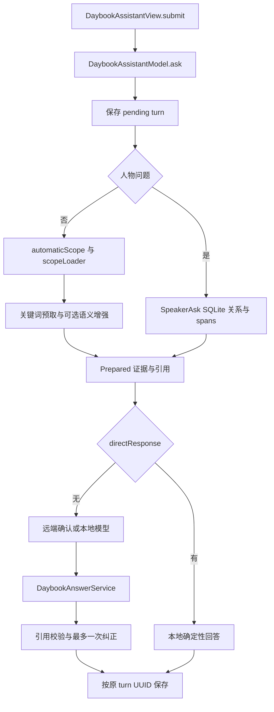
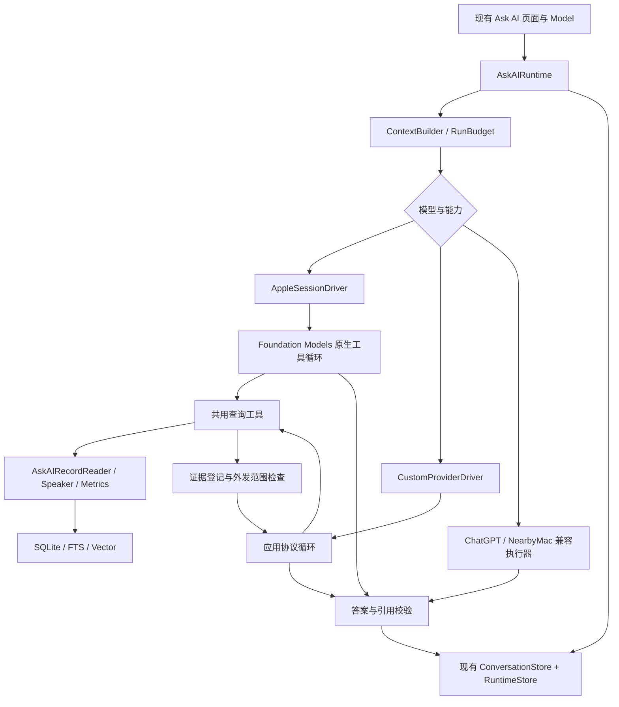
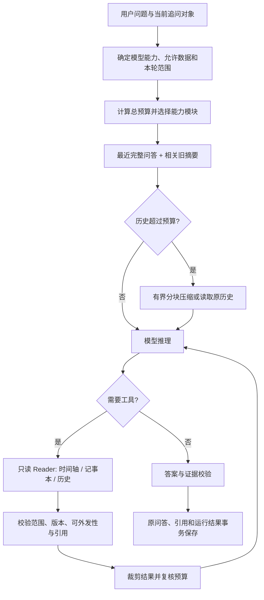

# Ask AI 会话、上下文与工具编排

> 2026-11-08 新增[第二期设计：历史压缩与记事本 Agent](#memory-notebook-agent-20261108)。用户已明确首期记事本范围为“查询、统计、关联分析和建议”，并赞成按 LLM 窗口预算加载／卸载能力。本节之后的首期实现事实保留；第二期具体方案待评审，尚未修改生产代码。

> 用户于 2026-11-01 回复“同意”，批准本方案实施。当前为首期运行时实现；自动验证、模拟器、真机和发布状态分别见第 12 节。
>
> 2026-11-01 读取本地工作区，HEAD 为 `99b203c`，存在大量未提交修改。本文的现状结论对应当时工作区内容，不能只用该提交号还原。此前暂存于 `/tmp` 的设计稿由本文接续；后续持续更新本文。

## 2026-11-02：历史展示与输入响应

- AI 页以 SQLite `conversation_turns` 保存的消息为展示来源：问题、回答、时间、模型、引用和范围说明均使用当时保存的版本；先加载已有 10 条分页，再按用户操作加载更多，界面使用这些档案的内存快照。
- 切换 AI Tab、聚焦输入框、键盘变化、打字与滚动不触发原始转写读取、来源指纹计算、说话人历史查询或模型生成。历史不因当前选中日期变化或暂时没有源记录而丢失；关闭来源权限仍立即隐藏相关回答与引用。
- 历史引用表示生成时使用的来源。点击引用才打开当前原始记录；从历史回答加入行动／设置提醒时，异步读取必要范围、在后台核对指纹，资料已变化则提示先重新回答。重答、外发确认和运行中的资料变化继续核对当前证据，旧回答不能直接成为新事实。
- 本轮不修改 SQLite schema，不重新生成或重写历史正文。验证和真机安装状态见[持续验证记录](../verification/2026-10-23-persisted-timeline-recap-refresh.md#ask-ui-lag-20261102)。

## 1. 目标和结论

在 iOS 26.3 上增强连续追问、历史压缩、按需读取原文、多轮工具查询和跨类型统计；保持 SQLite 为历史与业务数据的主存储。

**采用“现有 Ask AI 链路 + 应用层运行管理 + 按模型能力选择执行器”。** Apple 模型使用 Foundation Models 原生会话和 Tool；自定义云端模型由应用适配 OpenAI Chat Completions / Anthropic Messages。ChatGPT 账号和本地 Mac 保留现有传输，未验证工具能力前继续使用确定性检索与一次回答。

这次更新相对初稿的主要修正：

1. 历史存储、10 轮分页、发送后清空和权限清理已经存在，直接复用。
2. 复用 `conversation_turns` 的一轮一行结构；新增运行附属表，不建立第二套 message/conversation 主表。
3. 保留 Apple、ChatGPT、自定义、本地 Mac 四类配置，而非只覆盖 Apple 与自定义服务。
4. 总上下文预算包含历史、系统指令、工具与返回值；现有 1400 字只限制证据正文。
5. 云端新取得的工具结果受原有发送确认规则约束，第一次确认不自动授权后来取得的所有资料。
6. 先分离查询与全量索引维护，再开放多次工具检索，防止局部查询导致其他范围的向量缓存被清理。
7. 记录查询先覆盖现有七类来源；记事本想法/账目有独立数据和权限接入工作，不能假定已经是普通 DayRecord。

关联主要说明：[存储与检索](local-storage-and-retrieval.md)、[数据库与生命周期](local-data-schema.md)、[Prompt 目录](ai-prompts.md)、[Ask AI 产品行为](../prototype/ai-date-range-design.md)。本说明与这些主要文档同步维护；下方“首期实现边界”区分已落地代码和后续设计。

## 首期实现边界（2026-11-01）

本节是当前代码落点。第 2、3 节保留实施前的审阅事实；后续章节描述完整目标，不代表所有演进项都在首期交付。

| 能力 | 当前实现与边界 |
| --- | --- |
| 运行管理 | `AskAIRuntime` 管一次 attempt、最多 6 次工具、8 次请求额度、90 秒活动时间；确认等待不计时；引用修复、超限重建共享额度 |
| Apple 26.3 | `AskAIAppleDriver` 注册一个原生 `readLocalRecords` Tool，内部派发四种只读能力；检查系统模型/中文可用性；框架内部推理步数不可精确计数 |
| 自定义模型 | `AskAICustomDriver` 支持 OpenAI Chat Completions / Anthropic Messages；每轮先用无个人数据的探测请求验证工具能力；不支持则回到原文本服务；未做跨轮能力缓存或 SSE |
| 其他模式 | ChatGPT 账号与附近 Mac 保留原传输，使用本轮已经预览的有界指令/正文；不冒充支持工具 |
| 上下文 | `AskAIContextBuilder` 包含指令、问题、schema、证据和 25% 估算余量；首轮≤2200，工作输入≤3584，输出预留 512；自定义配置更小时进一步收缩 |
| 历史 | SQL 读取最多 40 个完成轮次，不受 UI 已加载 10 条限制；最近最多 3 条用户问题＋最多 12 条问题的确定性意图记忆。**不是完整对话的语义摘要**，不保证“你上一条第 2 点”等依赖旧回答文案的追问 |
| 输出边界 | Apple 原生及 Ask AI 自定义接口（包括不支持 tools 的文本回退）按 512 输出上限；旧 Apple 文本兼容路径为 400，ChatGPT/Mac 继续原传输的输出设置，不声称可控制第三方内部推理步数 |
| Apple 检查点 | 仅完成且未调用工具的 Transcript，绑定完整输入/配置/来源/权限；损坏、超预算或不匹配就丢弃。只优化相同上下文的重试，尚非通用跨轮 Session 复用 |
| 只读工具 | `AskAIReadTools` 提供 searchRecords/readRecord/aggregateMetrics/searchConversationHistory；参数、日期、来源权限和人物关联均受原范围约束；每次实际新增外发工具文字单独确认 |
| 取数 | 初次检索继续复用现有 scopeLoader、关键词和可选向量增强；运行内工具使用本轮完整范围快照与 freshness 回调。**尚未把 Reader 从 View 全面抽取，也未完成 Speaker SQL 日期下推/统一时间语法** |
| 统计 | 结构化步数、睡眠、运动；最多 5 条可引用样本的确定性小计，超限明确 partial/excludedByLimit；未知不当 0。尚非任意长范围的全量健康比较 |
| 索引 | 范围查询仅 upsert；只有权威维护/明确删除才清理全库条目；翻译 await 后重检相同 UUID 的投影，避免跨日期复用错误 |
| SQLite | 复用 conversation_turns，新增五表；成功 attempt 与最终答案同事务提交；资料复核期间暂停发布许可，仅最新且未变化的复核可恢复；清理缓存有持久代次与提交时取消校验，迟到任务不能复活缓存 |
| 交互 | 问题保存后清空输入框；原位重新回答保留 turn ID、日期和已有成功答案；失败/取消不抹掉成功答案，草稿不受重试影响；阶段进度不包含未经校验的流式答案 |

未在本期完成的演进项：丰富的语义历史摘要、Speaker SQL 下推、独立 Reader、可分页的全量指标聚合、跨轮工具 Transcript 恢复、流式输出、跨轮能力缓存、30 天诊断摘录自动清理、可配置 UI 功能开关、记事本查询。无支持能力时可走文本兼容路径，但没有新增面向用户的运行时开关。

## 2. 实施前基线：已从代码确认

### 2.1 入口与完整链路

| 现状 | 代码证据 | 对本次设计的影响 |
| --- | --- | --- |
| 输入持久化成功后立即清空，失败保留草稿 | [DaybookAssistantView](../Sources/iPhone/DaybookAssistantView.swift) `submit`；[DaybookAssistantModel](../Sources/iPhone/DaybookAssistantModel.swift) `ask` | 保持接口的 accepted 语义 |
| 所有历史存 SQLite；跨日期分页，每次 10 轮 | [DaybookConversationStore](../Sources/iPhone/DaybookConversationStore.swift) `loadPage` / `saveTurn` | 保留 `(created_at,id)` 游标和 turn ID |
| 重启把 pending 转 cancelled，并显示中断文字 | 同上 `interruptPending` | 新 run 可记录 interrupted，旧 turn 状态继续兼容 |
| “重新回答”调用 submit，当前会新建一轮 | AssistantView `retryButton` | 原位重试是新增行为，需要显式 `retry(turnID:)` |
| 最近 3 个 completed turn 用于意图与追问 | AssistantModel / [DaybookRetrieval](../Sources/iPhone/DaybookRetrieval.swift) | 当前无滚动摘要；摘要是新增功能 |
| 日期规则解析、范围加载和一次扩大范围已存在 | Retrieval `automaticScope`；[DaybookView](../Sources/iPhone/DaybookView.swift) `loadRecapRecords` | 不重复新建日期规划器；LLM 参数必须服从显式日期约束 |
| 一般问答最多 5 个来源、每段 200 字、证据正文 1400 字 | Retrieval `Limits`、`prepare` | 这些不是总 token 上限，不能作为会话窗口保证 |
| 每轮用户问题最多 300 字、旧回答截到 500 字后追加到证据正文 | Retrieval `prepare` | 旧链路可再追加约 2400 字历史，需总预算而非只调片段长度 |
| Apple 每次 generate 新建 Session、输出上限 400 tokens，未传 tools | [DaybookAnswerService](../Sources/iPhone/DaybookAnswerService.swift) `generate` | 本期新增可恢复会话与 Tool，不假设已有原生 Agent |
| 来源编号白名单校验，失败再请求一次 | AnswerService `DaybookAnswerCitationPolicy` | 复用规则，修复调用计入统一预算 |
| 自定义两种协议均一次文本请求、`stream=false` | [CustomAISummarizer](../Sources/iPhone/CustomAISummarizer.swift) | 需要新增结构化工具/流式适配，不能只传 tools 字段就完成 |
| 配置支持 local / chatgpt / custom / nearbyMac | [AIConfiguration](../Sources/iPhone/AIConfiguration.swift) | 保留四模式和各自凭据边界 |
| 远端发送默认预览，支持用户选择免提示 | AssistantModel `confirmRemote`；[AppSettings](../Sources/iPhone/AppSettings.swift) `authorizeRemoteAISend` | 所有新网络步骤沿用偏好、配置版本与证据版本检查 |

### 2.2 已有可复用基础

- `DaybookEvidenceSnapshot` 记录日期、允许来源和内容指纹；人物问题还带 contact ID 与 speaker fingerprint。
- `questionReferenceIDs` 保存用户上一轮编号对应的 UUID。新一轮会重新映射编号，不能让旧 `[1]` 错指新资料。
- `DaybookSemanticIndex` 已包含 FTS、Apple embedding、SQLite Vector、查询翻译、覆盖进度与 generation 防迟到写入。
- 人物查询已经通过 `contacts → recording_speaker_contacts → audio_transcript_spans` 找资料，并校验 `speaker_revision`；当前没有 speaker 专属向量索引。
- `ContentModelBudget.estimateTokens` 已有混合文本估算能力，但位于内容加工模块；抽出纯估算函数供 Ask AI 复用，不直接沿用分段任务的预算配置。
- `DaybookDatabase` 已有 `NSRecursiveLock`、FULLMUTEX、WAL、FULL synchronous、5000ms busy timeout、绑定参数及迁移事务。它不是整个应用唯一写连接；多个 Repository 可各持一条连接。
- 当前 DB 文件保护为 `completeUntilFirstUserAuthentication`，DB 所在 Application Support 树排除备份。旧说明中 `complete` 的描述需要勘误，不能据旧文档改回保护级别。

## 3. 实施前发现的问题与目标优先级

以下为代码审阅得到的风险或缺口，除单独标明的测试外，未声称已在用户真机复现。

| 优先级 | 问题 | 具体调整 |
| --- | --- | --- |
| P0 | 1400 字证据后继续追加历史；无总窗口控制 | ContextBuilder 统计全部输入并预留输出/工具空间 |
| P0 | 没有持久摘要、会话快照与工具循环 | 新增 AskAIRuntime，保留现有回答接口作为兼容路径 |
| P0 | 模型工具补查会扩大实际外发内容 | 新资料先登记证据，再通过外发范围授权后交给远端模型 |
| P0 | 当前最终 turn 校验限制 sources≤5、snippet≤200、title≤48 | 工具内部证据与最终可显示引用分层，最终投影遵守原限制 |
| P1 | 活动任务可能因无关记录更新被取消 | 将范围指纹和运行版本与 UI 全量数组变化分离；仍对命中来源/查询范围内新增删除失效 |
| P1 | 语义 search 会同步全文并 reconcile；提供的 records 缺失项会被视为删除 | 工具使用查询接口，权威删除只来自全量快照或 tombstone |
| P1 | 全局 semantic generation 随范围变化，两个范围并发可能互相失效 | 同轮语义查询先串行；分离查询取消令牌与全局资料/资源修订 |
| P1 | Speaker snapshot 先读该人的所有关联 spans，再筛时间；currentFingerprint 再读一遍 | 把日期、source、speaker 和分页约束下推 SQL，指纹使用相关关联/处理版本 |
| P1 | “重新回答”新增用户消息 | 增加 attempt，复用原 turn ID、created_at、day 与 position |
| P1 | 查询 loader 位于 View，组合多个内存数组与内容 Repository | 抽为 AskAIRecordReader，保持当前有效内容片段、占位过滤与去重逻辑 |
| P2 | 想法/记账未进入现有七类 DayRecord 查询 | 单独增加记事本读取范围、来源引用与权限，不能仅扩大 prompt |

`sourcesChanged` 目前包含 `isPending && latestRecords != records`；`DaybookSemanticIndex.Worker.reconcile` 以传入 records 建 current 集合并删除未包含记录。这两处不能原样包进多次 Tool 调用后就假定支持独立范围并发。

## 4. iOS 26.3 兼容边界

### 4.1 已核验工具链

2026-11-01：Xcode 26.3（17C529），`xcrun --sdk iphoneos --show-sdk-path` 指向 iPhoneOS26.2.sdk。已读该 SDK 的 FoundationModels.swiftinterface；设备实际系统版本和推理可用性本次未测。

| API | 本期策略 |
| --- | --- |
| LanguageModelSession、Tool、Generable、streamResponse、prewarm | 可使用；本地 SDK 已包含 |
| Transcript Codable / init(model:tools:transcript:) | 可保存、恢复；Session.transcript 只读，需要裁剪时重建 Session |
| availability、supportsLocale | 每次启动运行前检查 |
| tokenCount、contextSize | 本期不用；当前 SDK 没有，采用保守估算与超限恢复 |
| 自定义 LanguageModel / Executor | 当前系统框架无法用来装载第三方模型；应用层自己适配 |
| DynamicProfile、DynamicInstructions、toolCallingMode、transcriptErrorHandlingPolicy | 不用于 26.3；作为 iOS 27 适配方向 |

本期捕获旧错误 `LanguageModelSession.GenerationError.exceededContextWindowSize`，不照搬新版错误类型。旧 SDK 编译时仅加 `#available` 无法识别新 SDK 才定义的符号。

## 5. 增量架构

### 5.1 组件落点

| 组件 | 现有代码的处理方式 |
| --- | --- |
| DaybookAssistantView | 保留输入、分页、来源导航；增加运行阶段和原位重试事件 |
| DaybookAssistantModel | 保留公开 UI 状态与同步入口，逐步把长任务编排委托给 Runtime；保持 version/configRevision 检查 |
| AskAIRuntime（新增） | 每轮状态、预算、取消、驱动选择、证据与许可；同一 AI Tab 只运行一轮 |
| AskAIContextBuilder（新增） | SQLite 历史、摘要、意图、引用身份与总预算 |
| AskAIRecordReader（新增） | 抽取 loadRecapRecords 的取数规则；避免直接让 Tool 依赖 View |
| AskAIToolRegistry（新增） | 参数与范围校验、共享计数、只读工具、重复查询检测 |
| DaybookConversationStore | 保留现有分页/turn 主数据；增添按 ID 读写及重试所需接口 |
| AskAIRuntimeStore（新增） | 管 run、tool call、evidence、memory、checkpoint 附属表 |
| DaybookAnswerService | 保留旧单次回答与引用校验；Siri 等原调用方继续可用 |
| CustomAISummarizer | 保留总结/回顾/标题路径；抽取可复用安全传输，Agent 协议 DTO 独立维护 |

业务层 `AskAIModelDriver` 是应用自己的协议，不能与 iOS 27 的 `FoundationModels.LanguageModel` 混用。统一接收 TurnContext，输出运行事件和最终答案；能力按提供商配置 + model ID 存储。

## 6. 会话、历史与压缩

### 6.1 延续原有存储

现有 `conversations(day,updated_at)` 用 day 分桶，AI Tab 用 `conversation_turns(created_at,id)` 跨日期显示连续历史。**本期保留这套组织，不重建 conversation 主键、不把每个日期变成独立聊天。** 运行缓存采用应用定义的 `session_key = assistant-default`。

三层数据：

1. 完整历史：仍是 conversation_turns，除已有权限清理/用户清除外不自动裁剪。
2. 工作上下文：最近完整轮次、当前意图、经过核验的本轮证据，有界且可重建。
3. 滚动摘要：主题、人物 ID、日期范围、未完成问题、用户明确陈述和 source refs；保存覆盖游标与依赖指纹。

历史回答只作对话背景。引用事实必须重新从有效业务记录取得；自动摘要不可把模型推断转为用户事实。删除来源后的旧历史可显示过期提示，但不得重新进入事实上下文。撤销读取权限沿用现有更强规则：保留问题，清除相关回答和引用，并清除受影响摘要、工具摘录和检查点。

### 6.2 上下文预算

优先复用并抽出 `ContentModelBudget.estimateTokens` 的纯计算函数，另建 Ask AI 配置与误差余量，不改变内容分段参数。

总预算包含：系统指令、当前问题、历史/摘要、工具 schema、工具调用参数及结果、答案 schema 和输出预留。当前实现的 `maxContextCharacters` 仅保留为旧路径保护，不再承担总预算职责。

初始参数为设计值，需要真机校准：

| 项目 | 初始建议 |
| --- | --- |
| Apple 26.3 窗口基线 | 4096 tokens，按旧官方模型说明配置 |
| 首次总输入估算上限 | 2200 tokens，包含工具与输出结构 |
| 最终答案输出预留 | 512 tokens；现有旧路径仍为 400 |
| 单工具正文 | 默认约 400 estimated tokens，受剩余预算进一步缩减 |
| 近期历史 | 从最多 3 个完成轮次开始，按预算减到 2/1；不是固定保证长度 |
| 最终可显示来源 | 延续≤5，每个 snippet≤200、title≤48 |
| 用户问题 | 延续≤300 字，避免同时改变现有存储/输入契约 |

估算器不是精确 tokenizer，工具循环仍可能超限。达到预算阈值时压缩较早完整轮次、减少原文、保留来源 ID；工具调用/结果成组处理。超限最多重建重试一次；不能在已满 Session 内继续追加“请压缩历史”。

摘要任务按 `session_key + covered_cursor + input_digest + prompt_version` 去重，在完成边界按需运行，不由页面刷新或无关资料更新触发。失败保留原历史并缩短窗口。

### 6.3 Apple Transcript 使用策略

- 首期先从规范化历史构建小型 Transcript，再支持同一会话在条件稳定时复用。
- 仅保存已完成 response 后的稳定快照，不保存进行中的半个 tool call 作为恢复入口。
- 快照绑定 provider/model、指令/工具版本、上下文覆盖游标与数据/许可指纹。
- 资料或权限依赖变化、配置切换、解码失败、系统版本不兼容时丢弃快照，从规范化历史重建。
- SDK 升级不要求迁移 Apple 内部 Transcript 格式；它是可删除缓存，不影响历史可读性。
- Siri 保持本地、受限来源、无聊天历史写入的现有边界，不隐式继承主聊天的云端配置。

## 7. 工具设计与真实数据边界

| 工具 | 实现入口 | 输出与约束 |
| --- | --- | --- |
| searchRecords | Reader + Retrieval + SemanticIndex 查询层；人物转 Speaker Repository | 短结果、稳定来源身份、覆盖状态、cursor；明确日期不自动扩大 |
| readRecord | 内容片段/原文 Repository；speaker 约束下的 spans | 有界原文与位置；重新核验版本、删除、权限 |
| aggregateMetrics | 结构化来源 Repository + 确定性统计 | 数值、单位、样本、缺失、时间归属、统计证据 |
| searchConversationHistory | ConversationStore 增加有界条件查询 | 当前连续会话历史摘录及原引用；不把旧答案作为新事实 |

统一返回 `ok / empty / partial / unavailable / ambiguous / error`，附 `evidenceIDs`、`hasMore`、`nextCursor`。参数枚举和时间范围均由应用校验，模型不能传 SQL 或绕开 allowedKinds。

### 7.1 记录与说话人

- 复用 `ContentSegmentPresentation.evidenceRecords` 的父录音/内容片段投影规则，防止把同一录音和派生片段重复统计。
- 人物检索保留 source_key + speaker_id + speaker_revision 校验；人物绑定仅对对应录音源有效，不推断跨录音声纹身份。
- 联系人姓名可用于理解，手机号、邮箱和头像不进入模型上下文。
- 人名精确关联不依赖向量已就绪；语义不足时仍返回关键词和范围内可用证据。
- Speaker SQL 先限制日期和来源，再分页读取 spans；不要在每次 `isCurrent` 检查中重新加载整个人的历史逐字稿。
- 普通查询与 Speaker 查询共享统一时间解析结果，补齐当前 Speaker 路径只单独处理部分日期表达的差异。

### 7.2 语义索引的接入前置条件

现有 `search` 兼具维护索引和查询职责。工具调用必须将它们分开：

1. corpus maintenance 消费权威完整快照或明确删除事件，才能清理其他记录。
2. 查询只按范围读 FTS/Vector；缺失条目可做有界 upsert，不把范围之外的记录当作删除。
3. 资源修订、资料修订与查询取消分别管理。第一版同轮向量查询串行，避免全局 generation 互相取消。
4. 每个用户 turn 合计最多推进 64 个缺失语义分段，不能每次工具调用都重新得到 64 个额度。
5. 复用已安装资源和端上查询翻译；原问题继续决定姓名、日期、筛选、历史和回答，译文只用于向量输入。

索引不完整时输出 partial 和覆盖度，不阻塞整个 Ask AI 等待全库建完。不新增独立向量数据库或云端 embedding。

### 7.3 统计与记事本

现有统计仅覆盖记录数量、类型数量及录音时长；“跑步后的睡眠比较”是新增能力。`life_records.metric` 同时承载不同含义，不能直接对 `.activity` 或 `.sleep` 行无差别 SUM。

SQL 负责筛选、去重和可以确定表达的聚合；`life_moment_metadata` 解码、睡眠区间合并等由现有确定性 Swift 算法处理。运动按实际 WorkoutMoment 识别，避免与步数、运动分钟、昨日归档卡重复；睡眠用有效主睡眠和区间，不叠加总计卡、起床卡与占位卡。标明快照刷新时间、缺失日期，空值不当 0。

`flash_assets` 已有 idea/expense、币种、方向和整数最小货币单位；当前 `DayRecord.Kind` 只有 voice/thought/image/activity/sleep/calendar/location。新增账目查询须扩展来源权限与引用导航，按币种分别汇总 `ready=1 AND revoked=0` 记录，不隐式折算货币，也不因允许读闪念就默认允许读其独立保存的全部账目。此项放后续阶段，并先补原型评审。

## 8. 四类模型与外发许可

### 8.1 执行能力

| 模式 | 当前代码 | 本期策略 |
| --- | --- | --- |
| local | SystemLanguageModel，一次 respond | 新增 AppleSessionDriver；框架负责内部工具循环 |
| custom/openai | 自建 JSON + URLSession，文本响应 | 新增 Chat Completions 工具 DTO 与循环；之后支持 SSE |
| custom/anthropic | Messages API，文本 block | 新增 tool_use/tool_result 与 stop_reason 处理；之后支持 SSE |
| chatgpt | ChatGPTAccountModel.complete，账号/用量/模型目录检查 | 先保留现有文本路径，不把账号凭据当 API Key；工具能力另验 |
| nearbyMac | 配对、证书 pin、局域网请求，stream=false | 保留身份/就绪检查；工具协议需 Companion 同步支持后启用 |

能力按 provider 配置修订 + model ID 缓存，unknown 不等于支持。保留已有 `contextWindowTokens` 配置，不能根据模型名猜容量。无工具能力使用本地确定性检索 + 一次回答，不自动转到其他服务。

协议执行器必须正确配对 call ID、参数分片、结果角色和结束原因。OpenAI 的 `tool_calls`、Anthropic 的 `tool_use` 在旧 Summarizer 中会视为非正常结束，须使用新的专用响应解析，避免影响现有总结/标题任务。

复用当前 HTTPS/loopback 校验、禁止重定向、临时 URLSession、凭据隔离和错误脱敏；每次外发前重检配置修订、用户授权和来源。不能仅检查响应回来后是否仍有效。

### 8.2 保持已有确认偏好

`requiresRemoteAIConfirmation` 默认 true，只有用户实际确认且勾选免提示后才关闭。设计采用以下规则：

- **确认开启：**先在本地取得最小证据，预览本次实际发送的历史摘要、问题、证据及目标。形成绑定内容指纹的发送许可。
- 远端工具请求只能在手机本地执行；结果先进入 EvidenceLedger。在新结果尚未获准外发时，不交回远端模型。
- 结果处于已确认内容内时可复用许可；新增正文、不同来源或不同外发目标时暂停，聚合新增内容后显示补充预览。
- **用户已选择免提示：**沿用现有偏好，允许在当前来源权限与任务范围内继续查询和发送，不额外重复确认；旧预览已经失效时仍拒绝沿用。
- 本地 Mac 在现有代码中也属于 isRemote，使用同样的离开手机前确认规则；提示为局域网发送，不标成公网云端。
- 用户等待确认期间暂停计算执行期限，但仍响应取消；恢复时重新检查数据和配置，重新计算剩余预算。

历史压缩若使用远端模型也会发送历史，必须受同一许可约束。确认开启时，不能悄悄在后台把全部旧对话发去生成摘要；可使用可用的端上摘要或确定性结构化裁剪。该产品交互在实施前更新现有 Ask AI 原型。

## 9. SQLite 增量设计

### 9.1 保留主表，新增五类附属数据

现有主表和列：

- `conversations(day, updated_at)`。
- `conversation_turns(id, day, position, question, text, generated, provider, evidence, sources, scope, question_references, state, created_at)`。
- turn 状态为 pending/completed/cancelled/failed/redacted；重启中断通过 cancelled + 提示表达。

新增五表已采用以下名称，统一由 RuntimeStore 的领域迁移 `ask-ai-runtime-v1` 创建，保持主 schema v16 的兼容方式，不与其他领域抢占全局版本号：

| 表 | 必要字段 | 约束与用途 |
| --- | --- | --- |
| ask_ai_runs | id、turn_id、attempt、session_key、provider/model/config_revision、state、started_at、ended_at、error_code、counters、result_payload | turn_id 外键级联；turn+attempt 唯一；保存每次尝试；result_payload 仅保存来源 UUID 列表，最终正文在原 turn |
| ask_ai_tool_calls | run_id、call_id、tool_name、args_digest、最小参数、state、result_refs、耗时 | run+call_id 唯一；终止/重试可审计 |
| ask_ai_evidence | id、run_id、source_identity、source_version、query_scope、excerpt_range、permission_digest | 来源引用身份与有界摘录；不复制整份原文 |
| ask_ai_memory | session_key、anchor_turn_id、covered_cursor、summary_json、dependency_digest、prompt_version | anchor_turn_id 外键；覆盖游标后更新，权限变化可作废 |
| ask_ai_checkpoints | session_key、anchor_turn_id、provider_config_digest、format/tool/prompt_version、input_digest、payload | 仅最近稳定快照；可删除重建 |

本期只有 `assistant-default` 会话键，避免因引入新表顺带改变产品导航。历史分页继续读取原表；执行器与上下文恢复不依赖用户已滚动加载多少条。

### 9.2 原位重试与发布答案

新增 `retry(turnID:)`，读取原 turn 的 day/position/created_at，新增 run attempt；不调用现有 submit 再创建 UUID。UI 草稿与重试输入分开，重试不清空新写的问题。

旧最终回答保持可见，新尝试结果先存 run；成功时在短事务更新 conversation_turns。仅 active run 可以发布；迟到结果必须比较 run ID 与配置/证据修订。旧尝试和已完成内容不会被失败重试误覆盖。

最终投影仍最多 5 条短引用。工具过程可能访问更多证据，存入附属表；只选实际支撑最终答案的来源映射到 `[1]…[5]`。来源不足时收缩答案，不删掉必要引用后仍发布相应断言。

### 9.3 迁移、清理和回退

- 领域迁移事务中建表/索引，不改旧 turn ID、不重写所有历史、不运行模型或索引全库。
- 旧来源的 `provenance/sourceKey/speakerID/offset` 继续可解码，新增证据类型使用独立版本，不破坏旧 Codable。
- reset/清除历史与权限 redact 同步清理运行摘录、摘要、快照；附属 run 外键和 anchor_turn_id 防止旧版本清空主历史后留下可恢复缓存。
- 完整聊天遵循既有保留规则；诊断工具摘录 30 天清理仍是后续计划，当前随 turn 删除级联或权限清理删除。
- 功能开关可退回旧回答链路，附属表仍保留；不删除用户对话、不降级主库版本。
- `saveTurn`、run 发布和选中 attempt 的更新需要同一短事务，避免界面显示成功而历史指向另一尝试。

### 9.4 数据库锁与线程

沿用 DaybookDatabase 的同步事务 API，不在事务内 await。RuntimeStore 写入串行后台队列，较重读查询放 worker；调用回主线程发布 UI。语义和音频仓库继续各自串行，WAL 不能让多条连接同时写。

已存在 5000ms busy timeout，因此主线程访问在竞争时仍可能阻塞。设计要求将新 runtime 的 SQL 从 MainActor 移出，而不是仅增加 timeout。流式草稿最多每秒保存一次，最终状态立即保存；数据库错误只重试本次写入，不重新请求模型。

沿用 completeUntilFirstUserAuthentication 和排除备份设置；SQLite 本身不提供本稿所声称的额外数据库加密。

## 10. 运行状态、限额与错误

运行状态：`preparing → awaitingConsent? → generating ↔ toolRunning → validating → completed`。失败分 failed/cancelled/interrupted；它们先存在 run 表，最终映射到原 turn 支持的状态。

默认建议：每个用户 turn 最多 6 次工具调用、云端最多 8 次模型请求、执行预算 90 秒；用户等待确认不计入该执行时间。引用修复、超限重建和语义修复均计入，不因重建 Session 重置额度。

- Apple 内部模型步数不可假装精确可控。通过共享工具入口计数、deadline 和 Task 取消控制；工具抛错后从稳定检查点恢复。
- 相同工具与参数优先复用结果；连续没有新增证据时停止该查询路径。
- 多工具并发共用预算；第一阶段涉及语义和数据库的查询串行执行。
- 预算耗尽后，剩余时间允许时用已取得证据生成一次无工具短答；否则显示部分结果与未完成原因。
- 流式个人事实先缓冲，取得证据后显示草稿；引用校验后才成为可点击来源。权限失效立即隐藏受影响草稿。
- 模型拒绝、资源未就绪、语言不支持、限流、凭据错误、无匹配和索引部分完成各自保留状态，不统一显示“没有记录”。
- 新记录在查询范围之外，不取消当前运行；在统计范围内新增/删除、命中原文变更、speaker 关联修订或权限变化，需要使对应证据失效。该范围指纹替换现有粗粒度数组比较前需专项回归。
- 初次完整范围读取尚未取得证据时，仓库进度通知只标记本次读取需要刷新，不按用户取消处理。串行重读最多 3 次，沿用已保存的问题 ID；持续变化则明确提示资料正在更新，不发送未核对的资料。资料复核中的临时 revision 冲突同样最多重读 3 次；文件／数据库读取失败不视为“没有资料”。
- 切换 App 内页面、短暂 inactive、切到其他 App 或锁屏不主动取消回答。任务由父页面的 `DaybookAssistantModel` 持有；实际进入后台且仍在处理时申请一个 `UIApplication` 有限执行租约，覆盖检索、生成和 SQLite 保存，不因内部阶段切换续期。返回前台、结束、失败或取消时释放。
- 系统租约到期或未获准时，取消当前任务并保存明确原因 `backgroundExpired` / `backgroundUnavailable`；旧租约的迟到回调不能中止新任务。iOS 控制后台时间，不保证长时间锁屏、端上模型后台推理或进程被终止后仍能完成；原问题保留，支持原位重新回答。
- 等待外发确认时不占用执行租约，不因页面关闭或后台化而授权／丢弃。返回页面继续确认；确认卡通过明确关闭按钮取消，禁止滑动误取消。麦克风输入仍在离开页面／后台时停止。
- 手动停止、模型设置、权限、来源和检索资源变化仍中断当前回答；已建立的运行将不含内容的原因码写入 `ask_ai_runs.error_code`，迟到的通用取消不能覆盖该原因。历史失败问题继续支持原位重试。
- 原位重试跨日期时，SQLite 按 turn ID 保留已有 `day`、`position`、`created_at`；传入日期仅用于新问题归档，重试不移动旧问题或创建空的当日会话。问题的资料范围重新解析，与历史归档日期分开。

本期四个工具均只读。闪念的自动创建逻辑继续使用现有动作仓库与幂等机制；后续 Ask AI 写工具要另做动作授权设计，Transcript 回滚不能撤销系统日程或提醒。

## 11. Prompt 与实现顺序

### 11.1 Prompt

Ask AI 的角色为温暖、坦诚、务实的 WiseLife 个人助手，结合获准记录中的明确偏好、目标、时间与精力，为生活、学习、工作提供适合用户的建议。当前意愿优先，不把单次经历当习惯、不把他人发言当用户偏好；先回答，再按需给 1–3 个具体小步骤及依据。区分观察、推测和建议，缺少个人信息时至多追问一个关键问题。此调整不新增长期用户画像、数据读取范围或写工具；完整有效提示词见 [Prompt 目录 9.2](ai-prompts.md#92-自定义-ai附近-macchatgpt-基础指令)。

现有 `localAnswerInstruction`、`associatedSpeakerAnswerInstruction`、`CustomAISummarizer.answerInstruction` 和编号修复规则保留其核心语义，集中加入 [Prompt 目录](ai-prompts.md) 的后续实现更新。

新增 prompt：`ask_ai_tool_system`（范围与工具）、`context_summary`（有界历史）、`answer_from_evidence`（来源与局限）、`repair_tool_arguments`（结构修复）。均有版本；输入材料与系统指令分开，工具参数由应用二次验证。

### 11.2 分阶段交付

1. **基线与上下文**：修正测试文案断言后运行完整既有回归；抽出估算函数，增加总预算和有界历史构建。现有分页、发送时机、权限行为作为回归要求。
2. **运行持久化**：五类附属表、原位重试、滚动摘要、稳定快照与重启恢复；增加运行进度的原型评审。
3. **查询适配**：Reader 从 View 解耦；拆开语义索引维护/查询；Speaker SQL 范围下推；四类只读工具和确定性统计。
4. **Apple 26.3 工具会话**：原生 Tool、引用与预算闭环、取消/超限恢复；在 iPhone 16 Pro 验证模型可用性与中文质量。
5. **自定义服务工具会话**：OpenAI/Anthropic 两种协议、外发预览增量、能力降级；ChatGPT/Mac 保持文本兼容执行器。
6. **后续扩展**：记事本权限与引用、ChatGPT/Mac 工具能力、iOS 26.4 精确统计、iOS 27 provider/DynamicProfile。每项独立验证后启用。

实现期间继续更新本文，不以每次聊天创建一份新设计。新交互先修改已有 Ask AI 原型；本轮已更新原型与 Swift；实际实现范围以本文首期实现边界及验证记录为准。

## 12. 验收与本次验证

### 12.1 验收矩阵

| 场景 | 通过标准 |
| --- | --- |
| Kate Bell + 连续“她提到的下一步” | 人物/时间延续，引用正确 speaker spans；向量未建完仍可精确关联 |
| 超过 10 轮与跨日历史 | 10 条分页无丢失，摘要覆盖可追踪，不依赖已加载 UI 页数 |
| 长中文/混合文本/工具 schema | 总预算有界；超限最多一次恢复；原历史完整 |
| 原位重试与迟到响应 | 保留 turn ID/时间，只有当前 attempt 能发布 |
| 向量查询范围 A→B→A | B 查询不删除 A 缓存；查询间不互相使全局资源失效 |
| 无关记录更新 / 范围内新增 | 前者不中断；后者使对应统计/查询证据重检 |
| 来源删除 / 关闭权限 | 历史按既有规则清理或过期；摘要/快照不能带回旧资料 |
| 录音分片与内容片段 | 不重复计数父录音与派生片段，原文按需分页读取 |
| 运动与睡眠比较 | 固定数据集的数值、去重、区间和缺失判断与基准一致 |
| 外发确认开启与免提示 | 新取得正文需要新增许可；免提示沿用已保存偏好；配置变更使旧许可失效 |
| OpenAI/Anthropic 多次 tool call | call ID 成对，参数完整，失败与限额可终止 |
| ChatGPT / 本地 Mac | 原连接与文本回答不回归，未支持工具不冒充支持 |
| 收录音同时 Ask AI | 无长事务/主线程锁等待扩张，存储重试不造成重复模型请求 |
| App 重启/取消/清空历史 | 任务可解释地中断，清空后旧缓存不能恢复聊天 |
| Siri | 本地、允许来源、无聊天历史写入的原行为保持 |

### 12.2 实施前基线检查（2026-11-01）

环境：当前 macOS 工作区、Xcode 26.3、HEAD `99b203c` 加未提交修改；只使用仓库合成测试，不读取用户数据库、密钥或录音。

| 检查 | 实际结果 |
| --- | --- |
| `sh apps/wrist-notes/scripts/test_speaker_ask.sh` | exit 0；输出 `SpeakerAskRetrievalSmoke passed: English/Chinese intent, exact names, dates, SQLite association, speaker isolation, privacy and stale revisions` |
| `sh apps/wrist-notes/scripts/test_conversations.sh` | 编译完成，运行 exit 133；在 DaybookRetrievalSmoke.swift 第 41 行断言中止，后续用例本次未执行 |
| 对失败的静态核对 | 测试期待“当前检索对象是已关联联系人的显示名「张毅」”，当前代码输出“当前检索对象是联系人「张毅」”。至少存在精确文案断言与实现不同，不能把此次失败报告为模型或数据库失败；修正断言需另行运行完整测试 |
| 文档与代码阅读 | 已核对上文入口、现有表、四模型分支、外发确认、索引维护及源码限制 |
| 文档检查 | 本文、文档总索引和存储说明的本地文件链接均存在；索引共 202 个唯一文件目标；空白与冲突标记检查通过 |
| iOS App 构建、模拟器 UI、真机推理、云端真实工具协议 | 本轮未执行 |

以上保留实施前事实。后续已将旧精确文案断言改为联系人身份与原文的语义断言；新增测试和最终结果见下节。

### 12.3 首期实施验证

计划：[本期实施计划](superpowers/plans/2026-11-01-ask-ai-runtime.md)。验证：[运行时验证记录](../verification/ask-ai-runtime-2026-11-01.md)。

2026-11-01 晚已在 iOS 26.3 隔离模拟器安装当前 App，以 9 条虚构记录完成 [10 轮个性化验收](../verification/ask-ai-runtime-2026-11-01.md#simulator-personalization)：9 轮豆包 OpenAI 兼容真实回答，其中一次实际工具补查；1 轮因运动主题误触 `.activity` 强制过滤而无结果。当前意愿、单次事件和他人发言区分有通过样例，相关性、资料不足声明与语义引用仍有缺口，不能判定个性化目标全部通过。10 轮 SQLite 保存、重启恢复、发送即清空、来源打开已核对。当前仅记录问题，未据此修改运行时或检索规则。

Apple 真正推理、其他真实模型服务、真机安装／推理及发布尚未执行；第 12.1 节完整运行时矩阵未在本次模拟器测试中全量覆盖。

## 13. 参考与版本说明

Apple 最新网页包含 iOS 27 API，26.3 实现以当前编译 SDK 为准。

- [LanguageModelSession](https://developer.apple.com/documentation/foundationmodels/languagemodelsession)
- [Transcript](https://developer.apple.com/documentation/foundationmodels/transcript)
- [工具调用](https://developer.apple.com/documentation/foundationmodels/expanding-generation-with-tool-calling)
- [上下文窗口](https://developer.apple.com/documentation/foundationmodels/managing-the-context-window)
- [WWDC25：基础会话、结构化生成与工具](https://developer.apple.com/videos/play/wwdc2025/301/)
- [WWDC26：Provider 接入](https://developer.apple.com/videos/play/wwdc2026/339/)
- [WWDC26：Agent 编排](https://developer.apple.com/videos/play/wwdc2026/242/)

源代码补充入口：[DaybookDatabase](../Sources/iPhone/DaybookDatabase.swift)、[DaybookSemanticIndex](../Sources/iPhone/DaybookSemanticIndex.swift)、[ContentModelBudget](../Sources/iPhone/ContentEnrichmentService.swift)、[ChatGPTAccountModel](../Sources/iPhone/ChatGPTAccountModel.swift)、[NearbyMacClient](../Sources/iPhone/NearbyMacClient.swift)、[FlashCaptureRepository](../Sources/iPhone/FlashCaptureRepository.swift)、[LifeSourceStore](../Sources/iPhone/LifeSourceStore.swift)、[LifeMomentBuilder](../Sources/iPhone/LifeMomentBuilder.swift)。

## 14. 第二期设计：历史压缩、记事本与模型能力预算（2026-11-08）

**状态：设计待评审，未实现。** 用户已确认记事本仅做查询、统计、关联分析与建议；支持按 LLM 实际可用窗口决定预算，小窗口可以卸载能力。本期不引入第三方 Agent 框架，不增加记事本写工具；在已有 `AskAIRuntime` 上演进。这里的卸载是从一次推理的上下文／工具集中移除，不删除模型文件、对话或业务数据。

### 14.1 方案选择与代码差距

| 方案 | 好处 | 局限 | 选择 |
| --- | --- | --- | --- |
| 最近完整问答＋分块摘要＋原文工具 | 能接连续追问，也能追溯更早细节；适配大小窗口 | 需要摘要版本与依赖管理 | 推荐 |
| 仅最近 N 轮滑动窗口 | 简单、延迟小 | 话题一长就忘记较早决定 | 作为失败降级 |
| 所有历史全文检索／向量召回 | 容易找旧主题 | 难以保持当前计划、修正及“上一条第 2 点”的语境 | 作为补充，不能替代会话压缩 |

当前代码核对：`AskAIRollingMemory` 保存至多 12 条截短用户问题，没有旧回答的语义总结；历史读取最多 40 轮。`AskAIRuntime.windowTokens` 仍将自定义服务配置夹到最多 4096，schema 固定装载四个现有工具。`DaybookEvidenceSnapshot`／`Source` 的范围绑定 `DayRecord.Kind` 与 UUID；人物 ID 为字符串、地点为格网 ID，不能直接塞入旧引用。当前记事本查询与详情已具备 SQLite 基础，但尚未进入 Agent。

### 14.2 统一运行流程

`AskAIContextPlanner` 负责预算与能力集合，`ConversationCompactor` 负责派生摘要，`AskAIRecordReader`／`NotebookAgentReader` 负责后台只读查询，`AgentEvidenceRegistry` 管理版本化引用。运行、超时、取消、外发确认和最终保存复用现有 Runtime；不让每个业务模块独立维护循环或上下文。

需要同步调整现有预取／directResponse 门控：时间轴首轮没有命中时，只要还有允许的记事本或历史工具，就继续工具查找，不提前返回“没有记录”。只有实际查过相应范围且状态为完整空结果时才能作此结论；权限未开、未建完索引或日期未覆盖分别处理。

### 14.3 根据模型窗口加载和卸载能力

预算依据为**当前选择的具体模型**及服务适配器，而不是仅按 local/custom 四种模式区分。窗口来源优先为可靠的模型能力信息、已确认的用户配置；未知时采用保守值并注明估算，不根据模型名字或一次请求成功推断窗口。iOS 26.3 Apple 路径继续使用保守 4096 token 配置和估算余量；未来精确 token API 按 availability 另适配。云端不再统一上限 4096，初版应用成本上限建议 32768，可与 provider 硬窗口分别记录。

预算约束：

`指令 + 本轮问题 + 历史/摘要 + 工具 schema + 证据 + 工具过程 + 输出预留 + 安全余量 ≤ min(模型窗口, 应用上限)`

- 工具的名称、描述、参数 schema、工具调用参数与返回结果都计入。统一模型请求构造处核算，避免同一问题被额外拼接后重复耗费窗口。输出预留建议小窗口 512、中等窗口 1024、较大窗口 2048 tokens；实际受服务输出能力约束。
- 输入估算继续覆盖中英混合并增加约 25% 不确定性余量；已计入估算的不确定性不重复收费。预算账本另显示 outputReserve 和少量 continuationReserve。大小窗口的分档只是默认策略，最终以实际构造出的请求能否容纳决定。
- 使用“允许能力 ∩ 模型支持能力 ∩ 当前预算可容纳能力”。模型不支持 tools 时，使用确定性查询＋文本回答兼容路径，不声称进行了自主工具循环。
- 工具按领域装载。公共搜索／读取接口、相关领域专用工具和历史回读按本轮需要选择；不把所有工具、全部人物／地点列表或整本记事本塞进 system prompt。保留一个紧凑能力目录，确保模型知道尚可查询的领域，避免关键词路由永久屏蔽相关能力。

| 可用窗口示例 | 默认能力策略 |
| --- | --- |
| 约 4K | 聚焦当前领域；1 轮最近问答优先、短摘要、少量证据；保留完成当前问题必需的工具，复杂跨领域关联可能受限 |
| 约 8K–16K | 通常保留 2–4 轮完整问答、相关分块摘要、按需记事本专用工具与有界关联分析 |
| 约 32K 及以上 | 增加相关历史、证据与跨领域比较范围；仍分页取数、控制成本和循环，不把全库注入 |

预算不足时依次移除：重复／已完成的中间结果 → 不相关旧记忆 → 本轮无关工具模块 → 压缩较早完整问答 → 缩短证据展示／分页读取 → 限制本轮跨领域分析范围。用户本轮问题、必要指令、工具调用与结果配对、数据范围、出处及输出预留属于必要内容。若最小配置仍装不下，明确提示当前模型窗口不足，不无休止重试。

对“本月餐饮支出”必须保留 SQL 统计能力，不能卸载统计后让模型估算。优先卸载与此问题无关的地点、人物深查等模块。受限能力在 Ask AI 显示简短说明，例如“当前模型窗口较小，本次聚焦记账；跨领域分析暂不可用”。不会永久修改用户设置。

执行过程中换工具集，必须等完整 tool-call/result 配对结束、无待执行调用后，在运行状态中记录后受控重建 Session；Apple 原生工具注册随新 Session 重建，不假设运行中可热修改。工具切换与溢出重建合计最多一次，不能借重建重置请求／工具次数。跨模型会话只复用应用层摘要与证据，不复用不兼容的原生 Transcript。

### 14.4 历史压缩与读取

**完整历史一直由 `conversation_turns` 保存，10 轮分页显示保持不变。压缩只生成给模型使用的派生视图。**

三层上下文：

1. **近期工作上下文**：优先放最近一轮完整用户问题＋AI 回答，预算允许时扩为 2–4 轮。旧回答标为“当时的建议／结论”，不能充当现时业务数据。用户本轮纠正与明确意愿优先于旧摘要。
2. **较早分块摘要**：每块按 token 预算收纳若干已完成轮次，通常不超过 8–12 轮；主题、人物、地点切换时保留边界。4K 模型每次优先载入一块短摘要，较大模型加载相关块，不拼接全部历史摘要。
3. **原历史回读**：升级 `searchConversationHistory` 查询 SQLite 中的已授权原问答，返回 turn ID 和短摘录；增加 `readConversationTurn` 按 turn ID 和范围读原问答。“把上一条第 2 点展开”优先读取上一条原答案及其原有序号，不依赖摘要复述，也不把“第 2 点”与引用 `[2]` 混为一谈。

摘要采用有来源的结构化内容：话题、用户明确陈述、AI 当时提出的方案、用户明确采纳／否定／修正、未解决问题、实体 ID 与原 turn 引用。用户未采纳的建议不得变成其计划；“你可能喜欢…”不得变成用户偏好；没有明确依据时记录不确定，不创建长期画像。金额、日期、名称与当前业务结论通过原条目复核。

压缩策略：

- 以预估上下文占可用输入预算约 75% 为触发参考，压缩后目标约 55–60%，实际依请求结构调整；不因 UI 加载到第 10 轮就触发。
- 已覆盖的原问答不重复压缩；新块从原始问答生成，避免多轮“摘要再摘要”持续漂移。每块保存被覆盖的全部 turn ID 与内容修订摘要。维护有界的近期游标，不在每次打开 AI 页时扫描全部历史。
- 必要时在新问题运行前做最多一次压缩请求；使用当前选定的生成模型／服务及现有外发政策，不偷偷切换云端。压缩是无工具的受限生成请求，不再启动嵌套 Agent Loop。该请求占当前运行的 8 次请求／90 秒额度，压缩子步骤建议最多 15 秒，并为最终回答保留额度。
- 历史量大时渐进补齐摘要；首开、迁移、切页和输入不触发全历史模型加工。不突破原模型窗口去批量总结全库。
- 压缩失败、模型未就绪或超时：保留原始历史，使用能装下的近期问答和按需历史检索继续。若必要语境仍不能读取则说明局限，不把失败变成丢消息或无限转圈。
- 中途工具返回膨胀时先裁剪／分页，不压缩未完成的工具协议；已完成的工具结果只保留引用、计算结果、下一步必需字段和查询句柄。

### 14.5 记忆持久化、纠正与权限

沿用主 SQLite，不建第二套聊天库。新增 `ask_ai_memory_blocks`（分块摘要、覆盖范围、摘要版本、生成模型、输入摘要、状态与预算信息）和 `ask_ai_memory_dependencies`（block → turn ID／实体引用／内容版本／权限依赖）。既有 `ask_ai_memory` v1 保留作兼容，不原地把旧 `questions` payload 改成不兼容结构。

- 新摘要只有在覆盖的原问答、相关权限、清理代次仍一致时事务提交。模型推理和读全文都在事务外；写库失败只重试落库，不重新调用模型。
- 同轮重新回答替换了答案、删除了被覆盖的旧轮次，均使对应摘要块失效，不仅检查最后一个 anchor。清空聊天、收回来源授权要同时清理或屏蔽派生摘要／索引／会话快照，迟到任务不得写回。
- 不再用“今天选了哪个日期”的整包 sourceDigest 决定一切历史记忆是否可用。会话摘要按自己的 turn／实体／权限依赖失效，当前证据另按查询范围和数据版本校验。
- 历史回答仍可按原规则展示其当时内容；失效表示不能拿它当现时事实。用户原话和 AI 建议作为历史语境仍需遵守当前权限，不能通过摘要绕回已禁用资料。
- 摘要及其引用继承所有来源的本地限制。仅本机可处理的原记录／派生灵感／历史，不得因先在本地压缩而变为可外发。切换服务前重新核算实际允许发送的摘要、问答与工具结果。

### 14.6 记事本工具与查询边界

保留已有四个时间轴／历史工具，新增五个领域能力。工具集按 14.3 装载；统一参数校验、超时、预算、权限和只读证据注册，模型不直接执行 SQL。`searchNotebook` 是广泛查找入口，专用工具承担精确统计与关联。

| 工具 | 主要输入 | 返回与边界 |
| --- | --- | --- |
| `searchNotebook` | 类型 ideas/ledger/people/places、query、可选日期／筛选、cursor、limit | 类型化 ID、标题、短摘录、版本、覆盖范围、SQL matchedCount；最多 10 条分页，禁止以当前 UI 已加载行数充当全库 |
| `readNotebookItem` | 类型、原始 ID、offset/cursor | 灵感正文／父来源摘要、账目字段、人物资料或地点资料；正文分页，敏感字段按需返回 |
| `aggregateLedger` | 起止发生日期、收支、币种、分类、groupBy | SQLite 精确计算总额、条数、分组、待补充数、范围和统计引用；不截前 5 笔来冒充全量 |
| `listPersonSegments` | contact ID、日期、cursor | 真实 speaker 绑定且区间相交的片段、全范围去重计数、该人物相关发言摘录、身份复核状态；不把整段别人的话归给此人 |
| `listPlaceVisits` | place ID、日期、cursor | 按自然日去重次数、当天来源、位置采样时间与日期依据、覆盖窗口；不据录音次数推断到访次数 |

时间范围按实体定义：灵感使用保存／创建时间，账目使用发生日期，人物资料本身不受“今天”限制，人物发言使用片段录制时间，地点使用保存的自然日期／时区。没有明确日期的资料查找不被首页选中日期强制截断；“本月”等相对日期统一解析为明确范围，工具最多在本次允许范围内查询。

四类具体规则：

- **灵感**：检索当前未删除正文、标题及用户保留的来源说明。手动、闪念、合并、AI 再创作来源明确区分；分析重复主题可以关联父子灵感，统计条数默认按当前实际条目计数，需要按原始想法去重时另说明口径。关联分析只给建议，不自动合并或写回。
- **记账**：金额按整数最小货币单位计算；不同币种分别汇总。默认排除 revoked 和 ready=false，另外报告待补充数量。缺日期账目不能被当作本月已确认收支；跨月编辑以最新发生日期为准。SQL 返回完整范围统计，超时／覆盖不足明确标记，不让 LLM 自行凑总数。
- **人物**：复用 contacts、关系表、speaker 绑定及内容片段。按姓名／公司／关系搜索，同名返回候选让用户选择，不自动合并；查资料默认不返回无关邮箱和手机号。回答“Kate 最近说了什么”先定位 contact ID，再取她的关联发言；“一起见过面”不能仅凭 speaker 绑定认定。
- **地点**：复用稳定格网 ID、人工名称／类型与现有证据。近 30 天按地点＋自然日去重，同一天多个录音、样本或照片仍为一次。现有重建索引主要覆盖近 30 天，因此工具必须返回 availableRange；更早范围不能返回 0 冒充没有到访，不在本期偷偷增加历史定位采集或保留期。位置样本关联长录音内容时校验采样时间／offset 与片段范围，不把一次坐标套到整条长录音；不能推断停留时长或完整轨迹。

关联分析使用两类关系：持久的显式关系（灵感父来源、speaker→contact、位置样本→原记录）和模型提出的主题相关性。后一类明确标为可能关联，不写回实体关系。没有 person/place 外键的账目不能仅凭相同日期就归给某个人物／地点。

### 14.7 SQLite、FTS 与 SQLite Vector

- 四类业务表仍是唯一事实来源，Reader 直接查询，后台 worker 分页返回；不复制成另一套 DayRecord。列表及聚合由 SQL 提供；FTS 和向量仅帮助定位候选。
- 账目数值、日期筛选、人物 ID 关系、地点天数用 SQL；实体名称／正文关键词用 FTS；灵感及文本主题相关性按需使用现有 Apple embedding＋SQLite Vector。编号／电话号码、金额和地理格网不做语义相似度事实判断。
- 新增有命名空间的 notebook 文本投影（`domain + 原始 id + revision + textFingerprint`）和 FTS 索引；如使用向量，记录模型／版本／语言／维度，沿用已有中英检索和端上翻译能力。不更换 embedding 模型。
- 索引按编辑／删除／合并增量更新，事务事件或 outbox 防漏；查询时以当前业务版本复核，旧索引命中不能返回旧正文。索引未完成时降级到 SQL／关键词，并显式说明语义覆盖，不阻断金额统计、人物精确关系或地点计数。
- 近期压缩摘要可先用 FTS 查找，首期不为每轮完整对话重复构建一套向量库。后续只有召回质量验证需要时再加。
- 只读查询不触发全库 reconcile 或持有长写事务。统计与其依赖版本在同一短读快照取得；构建摘要、FTS/向量耗时工作与 App UI 分离。

### 14.8 统一引用、统计证据与新权限

同时引入 `AgentQueryScope` 表达领域、允许数据、日期条件、实体及发送目的地；旧时间轴范围包装兼容，人物资料和无日期灵感检索无需伪造一天的日期。

引入独立版本化 `AgentEvidenceRef`，以 `{domain, entityID:String, revision, excerptRange, dependency, disclosurePolicy}` 标识。必须支持 UUID、`manual:/ios:` 联系人 ID、`grid-v1:` 地点 ID。知识引用不是只能指向录音。统计／搜索同时保存查询条件及范围版本，范围内新增、删除、改分类、跨月移动都要触发发布前复核，不能仅检查已返回的前几条 ID。无关领域更新不会让整段历史摘要失效。引用导航如下：

- 灵感／账目引用 → 对应记事本详情；人物引用 → 人物详情，具体发言 → 片段详情及该 speaker 摘录；地点引用 → 地点或具体日期来源。
- 账目合计引用 → 本次统计报告，显示日期、币种、筛选口径、有效／待补充条数和可分页明细。统计证据记录 query spec、数据版本／依赖及精确结果，不能把其中一笔当成合计的唯一证据。
- 对话引用 → 当时完整问答；它证明“当时讨论过什么”，不证明账目／人物资料现在仍如此。当前业务事实必须读取新版本。
- 每轮最后显示至多 5 个必要引用；查询内部可读更多条，但统计聚合不受 5 条展示上限截断。若 5 个出处不足以支撑所有断言，收缩本次回答范围。

建议新增 `ask_ai_turn_evidence_v2` 附属表承载统一引用、查询依赖和追问编号映射，外键指向原 `conversation_turns`，与成功答案同事务保存；旧 `sources` 继续存兼容的时间轴引用，编号不重新分配，旧版不能把记事本 `[n]` 错链接到录音。旧版只忽略无法展示的新来源，本期不把新 enum 原样写进旧 payload。历史页仅按需读取短引用；点击后再查询当前实体，已删除时说明来源不可用。

数据读取范围沿用现有设置，增加灵感／记账／人物／地点四类 AI 使用开关（在 AI 检索的数据范围内）。升级时新范围先为关闭，由用户在设置或首次使用的范围提示中选择开启并持久保存；首次提示与当前外发预览可合并展示。只涉及本地处理时不触发云端发送确认。关闭范围后工具、摘要、索引、历史外发和引用统一受控。

手动独立条目受该类别范围控制；读取由录音／图片／位置派生的原话、来源快照或关联片段时，同时尊重原来源限制。原音删除不自动删除已经独立保存的灵感；可引用仍存在的灵感正文，但不能恢复已删除的原音。已有 `requiresLocalAI` 与 EurekaRing 派生限制继续传播到摘要和统计／关联结果。

云端选择遵循既有确认偏好：只对将实际发送的新问答、摘要和工具文字做预览与授权，已授权相同内容去重；配置、接收方或内容变化后重新核对。受本地限制的资料在组装远端 prompt 前过滤，明确提示相关能力需本机处理，不把过滤结果当作“没有记录”。

### 14.9 交互与验收

UI 历史仍按 10 轮分页。必要时短暂显示“正在整理对话上下文”“正在查询记账”等阶段，正常命中缓存时不出现多余加载；窗口导致能力受限时显示简洁范围说明。失败不删除问题、原答案或新输入草稿。首期不增加新建／修改／删除／合并工具，也不会把“建议下一步”当成已完成的行动。

验收使用合成数据与独立 SQLite，至少覆盖：

| 场景 | 必须达到 |
| --- | --- |
| 50 轮混合主题后问“刚才方案第 2 点” | 读取正确原答案和上下文；原 50 轮内容、ID、顺序不变 |
| 用户把预算从 1000 改为 600／拒绝旧建议 | 后续遵循最新明确决定；不会把旧建议当已采纳 |
| 摘要覆盖中间一轮被重答／删除 | 相关块失效；原 anchor 尚在也不能复用旧块 |
| 摘要生成超时、后台中止或 JSON 错误 | 原历史完整，有限降级／明确局限，无无限循环 |
| 4K、16K、32K 与未知窗口模型 | 实际构造含 schema／结果的预算有界；按能力降级；每次请求能解释加载／卸载内容 |
| 大于 5 笔、跨月、多币种、已删与待补充账目 | 总额与 SQL 基准精确相等，统计引用可查看口径；不以展示条数截断合计 |
| 同名人物、重绑 speaker、混合发言片段 | 正确 ID 消歧，真实关联与版本核对，不冒认他人的话 |
| 一天 20 次地点样本、跨时区、查询超出 30 天 | 计 1 次，日期依据明确；超出覆盖报告缺口而非零到访 |
| 修改／删除灵感时向量未更新 | 返回当前版本或排除旧命中；金额统计不等待向量 |
| 权限关闭、切换云端、仅本机派生来源 | 旧摘要／索引／外发缓存不绕过限制；迟到响应不能复活被清理内容 |
| 跨类型建议：“结合最近想法和支出给建议” | 读取相关灵感与完整账目统计，区分事实／推断／建议，未执行任何业务写入 |

### 14.10 实施顺序

1. **共同基础**：模型能力与动态预算；类型化证据、读取范围、SQL Reader 和来源导航。明确最小必需能力与卸载规则。
2. **历史**：近期完整问答、历史原文工具、结构化分块摘要、依赖失效与降级；保留旧 UI 历史。
3. **记事本确定性查询**：先覆盖四类精确读／分页、全量账目统计、人物和地点显式关系；接入同一个 loop 与引用链路。
4. **语义关联和验收**：灵感文本投影／FTS／可选向量，四类跨领域建议；小／大窗口、Apple 与兼容云端分别验收。

这四步属于本次两项需求的实现顺序，不代表已完成。开发批准后更新[现有实施计划](superpowers/plans/2026-11-01-ask-ai-runtime.md)；本轮仅修改技术方案与索引，不运行真实模型、不修改设备数据、不发布。
