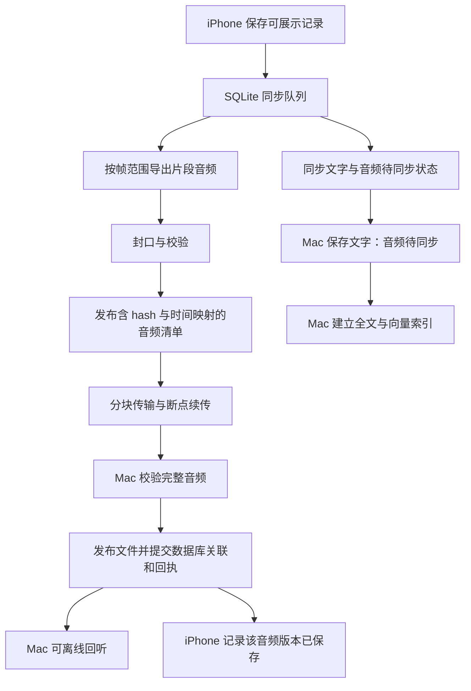

# iPhone 每日记录同步到 Mac

类型：产品与技术设计。更新：2026-11-04。
状态：方案待评审；用户已明确要求首期支持 Mac 回听，以及内容片段音频导出和传输。尚未实现本方案。
适用：WiseLife iPhone 与 WiseLife Mac Companion；不改变 Watch 已同步副本的 7／14 天策略。

关联：[数据生命周期](local-data-schema.md)、[Mac 推理服务原方案](superpowers/specs/2026-10-23-wiselife-mac-mlx-companion-design.md)、[已有 iPhone Mac 模型接入验证](../verification/nearby-mac-iphone-2026-10-25.md)。

## 1. 目标与当前实现

iPhone 自动向用户配对的 Mac 同步允许范围内的每日记录，Mac 独立保存、检索、回听；手机不在附近时，已同步内容仍然可用。首期建议一台 iPhone 对一台 Mac，iPhone 是同步记录的编辑来源，Mac 的批注和对话另存。

现有 `NearbyMacClient` 已实现 Bonjour、扫码配对、TLS 证书固定、Keychain 凭据和文字推理调用。Mac Companion 目前以本地模型服务为主；每日记录接收、资料数据库与索引需要新增。调用模型与长期保存资料是两种独立授权；旧配对不得自动获得资料同步权限。

现有 `RecordingRangePlan` / `RecordingRangePlayback` 按源文件帧范围播放内容片段；内容片段并非独立音频文件。其播放时间是各范围时长之和，真实录制时间按来源偏移映射，跨文件中断为标记，不自动填充静音。音频导出必须保持这一语义。

## 2. 建议同步范围

| 数据 | 首期建议 |
| --- | --- |
| 已完成、可展示的录音记录（单条直入或主题片段） | 全文、标题、摘要、时间／时区、来源设备、发言人关联，以及独立片段音频；单条直入记录导出其完整有效范围 |
| 闪念 | 原话、整理结果、想法／账目／行动及其关联；同一闪念的完整短音频只传一次，各结果引用同一个音频资产 |
| 图片记录 | 已导入 WiseLife 的图片与 OCR，不自动上传整个系统相册 |
| 已保存的每日回顾 | 按授权范围同步已有结果；同步不重新生成回顾 |
| 生活／健康／地点／系统日历资料 | 独立选择；来自这些数据的摘要与回顾也遵循相同范围，混合内容无法安全拆分时暂不发送 |
| 原始长录音与中间处理数据 | 不自动同步；内容片段音频只包含该片段引用的范围 |
| iPhone 对话、模型权重、向量、API Key、声纹、系统权限 | 不复制；Mac 对话和索引独立管理 |

首次开启“同步到 Mac”时说明文字、图片和音频的接收设备与保存范围。用户选择后，范围内的后续记录自动同步，不逐条确认。同步能力与 Mac 模型是否下载／加载解耦。

## 3. 片段音频导出

### 3.1 输出

- 每个内容片段对应一个可独立播放的 M4A 音频资产。一个片段跨多个原始文件时，按其有序 `ranges` 提取指定帧范围并顺序拼接。
- 只导出选定片段，不额外携带前后原音。声明的录制中断可拼接播放并保留标记；某个必要源文件缺失、校验失败或读取不足时，整体导出失败，不能省略缺失部分后宣称完整。
- 普通连续文件边界不应产生额外断点或重复音频。保留片段内部原有的真实静音；不为跨文件真实时间缺口合成音频。
- 首期采用 AAC/M4A 兼容格式；以现有语音采样格式为优先，必要时进行格式转换。使用有界 PCM 缓冲、单个导出 worker，避免把数小时原音读入内存，也不把整个片段当成 ASR 窗口重跑。
- 闪念优先复用已封口、校验可播放的现有短音频，不无谓重新编码。

### 3.2 独立音频清单

音频文件与清单配套保存。清单至少包括：

- 资料库 ID、记录／片段 ID、音频版本与导出格式版本。
- 文件 SHA-256、字节数、编码、采样率、声道、实际音频时长。
- 有序播放映射：输出播放起止位置、原始来源 ID、原始帧起止范围、实际录制时间和时区、中断标记。
- 转写时间定位信息及发言人引用；不包含 iPhone 沙盒绝对路径。

Mac 的播放器进度条用实际音频长度定位，时间标签显示真实录制时刻。跨录制中断时，时钟跳到下一真实时间，并显示中断提示；不能把缺口当作连续录制。

### 3.3 导出任务与版本

`待导出 → 导出中 → 已校验待传输 → 传输中 → Mac 已保存`；失败保留可重试状态，不阻塞文字展示。

导出固定来源版本及 ranges，并对依赖音频持有使用租约。写入临时文件，完成封口后检查实际可解码时长、映射一致性、文件大小和 hash，最后原子发布。时长检查考虑 AAC 编码填充，不能只相信容器元信息。

音频版本依据来源文件版本、有序帧范围和导出参数生成，与标题／摘要／发言人名字修订分开。仅编辑文字不重新传音频；拆分／合并／裁剪改变范围才生成新资产。完成前重新检查来源版本与授权，失效任务的结果不能覆盖新版。

## 4. 可靠传输与 SQLite

两端各自维护 SQLite，不复制正在使用的数据库文件。iPhone 的业务变更与 outbox 在同一事务提交；Mac 使用记录 ID＋版本幂等写入，旧消息不覆盖新记录，删除墓碑阻止旧上传复活内容。

建议增加的逻辑数据：

| 位置 | 数据 | 职责 |
| --- | --- | --- |
| iPhone | sync_peers / sync_outbox | 接收设备、授权范围、资料库代次、待传记录版本与重试状态 |
| iPhone | segment_audio_assets / segment_audio_export_jobs | 音频版本、依赖范围、输出校验与导出任务 |
| iPhone | sync_asset_transfers | 分块进度与 Mac 对指定资产的保存回执 |
| Mac | synced_records / synced_assets / record_asset_links | 独立记录、音频／图片资产、当前版本关联与播放映射 |
| Mac | sync_receipts / deletion_tombstones / index_jobs | 幂等确认、删除顺序、可恢复索引任务 |

表名是设计建议，开发时按现有迁移机制最终确定。所有文件路径在接收端生成，不接受发送端任意目标路径。

资产采用有界分块传输与断点续传；Mac 只在整文件校验并可靠发布、关联事务成功后发保存回执。文件发布与 SQLite 提交之间使用恢复日志：若进程退出，重启检查并完成提交或清理孤立暂存文件。回执丢失时按资产 ID＋hash 查询，避免重复上传。

记录可先进入 Mac 并用于文字检索，但音频未完成时显示“音频待同步”，不能标为可离线回听。Mac 磁盘满、部分上传、索引失败是不同状态。索引失败不应使已保存音频重新上传。

增加独立的资料同步 API 和能力授权，不复用 `/v1/chat/completions` 搬运媒体；复用现有设备身份、加密通信和发现基础。接收媒体无需加载 LLM。

### 4.1 兼容、迁移与恢复

- 两端协商同步协议、片段音频及续传能力；旧版 Mac 仅保留已有推理功能，提示升级，不误报资料已同步。
- SQLite 使用附属表和增量迁移，迁移失败回滚；不重建或清空现有业务库。停用同步后保留已保存记录，取消网络任务，不删除权威内容。
- 首次授权或扩大历史范围时，按稳定 ID 分批扫描已有最终记录。扫描期间继续记录新变更，结合版本核对与删除墓碑补齐，避免历史导入遗漏并发修改或复活已删除内容。
- 任务与回执按配对设备、授权代次和资料库代次隔离；收缩授权范围后取消未提交的发送任务。已在 Mac 保存的副本按第 6 节的独立移除规则处理。

## 5. 日期、更新与后台执行

- 按记录版本增量传输，按日期展示同步进度；不能把午夜视为当天数据永远完整。
- 晚到的录音片段、后补摘要、发言人修订自动更新原归属日期。保留录制时区，跨日片段使用同一资产多日期引用，不重复传输。
- 首次可选择从今天／最近 30 天／全部历史开始。已经同步过的旧记录不受该历史范围限制，其修改和删除仍同步。
- 在记录完成／修改、前台运行、发现 Mac、网络恢复和系统允许的后台机会尝试同步；文字优先于大媒体，暂停后下次继续。
- Mac 需运行且网络可达。iOS 不保证锁屏后持续导出、传输，也不保证准点执行；不能把 NWConnection 或 Bonjour 当作后台常驻能力。首次大批量历史传输建议保持 iPhone 前台。
- Mac 重建或恢复旧数据库时改变资料库代次并重新核对资产，不能沿用导致漏传的旧回执。

## 6. 保留与删除

- Watch 的 7／14 天清理只影响手表副本，与 iPhone→Mac 的片段音频任务解耦。
- iPhone 原始音频自动过期尚未实现。未来接入时，必须先保证待同步片段有已校验的独立音频；导出中源文件被租约保护，不能边读边删除。
- 到期时若必要片段尚未成功导出，保护其依赖源文件并提示导出失败／待处理；自动 TTL 不得绕过这一保护。闪念复用的短音频也属于待传资产，不能把唯一副本作为可丢弃缓存。用户明确取消回听同步并选择删除是另一条操作路径。
- 即使 Mac 长期离线，已经成功导出的独立片段仍可等待补传，不必为此一直保留完整长录音。待传片段可能持续占用手机空间，界面需显示体积与阻塞原因；不能为了释放空间静默删除唯一待传副本。用户可以明确取消上传并清理。
- Mac 确认保存后，iPhone 的导出副本可按后续本机缓存策略清理。若手机原音和片段副本都已清理，不能保证 iPhone 离线回听；从 Mac 取回音频属于后续能力。Mac 已保存的音频仍可独立回听。
- “清理本机媒体”不传播为 Mac 记录删除；“删除整条记录”默认传播到 Mac，移除索引与引用，无其他记录引用的音频再回收。
- 拆分／合并后先传新的记录及音频版本；Mac 不把旧音频冒充新版，旧记录按替代关系退出正常时间轴。旧资产在无引用且无传输／播放占用后回收。
- 暂停同步只停止发送；撤销设备阻止后续访问。已复制的资料不会因断开连接自动消失，移除 Mac 副本需独立执行；离线移除请求显示待执行，不宣称已远程删除。

## 7. Mac 体验与 AI

- 按日期浏览记录，详情提供播放器及“总结／全文”切换；时间标签沿用真实录制时刻。
- 全文点击可定位到音频；有转写时间映射时提供当前文字与发言人提示，旧记录没有精确时间戳时只提供普通播放，不能伪造定位。
- 首期不重新 ASR、不因为同步重新生成已有每日回顾。Mac 自建全文及语义索引，向量带模型版本，不混用 iPhone 向量。
- Ask AI 检索文字和结构化证据，回答附记录引用；引用可打开片段并回听。有精准证据时间映射时才跳到相应位置。
- 设置展示目标 Mac、范围、历史范围、待传条数／音频体积与最近成功时间；按天区分文字已保存、音频待传、可离线回听和索引进度。

## 8. 验收要求与当前状态

设计验收：本轮明确新增独立内容片段音频与闪念音频同步；整体协议、默认范围和清理交互仍待评审。

开发后至少覆盖：

1. 单文件裁剪、跨多个文件、录制中断、跨午夜及不同时区，验证真实时钟映射与播放时长；听感无重复句、截断、非预期长静音。
2. 缺源文件时不发布不完整音频；长原音导出使用有界内存，后台中断后可恢复／重试。
3. 闪念多个整理结果只上传一份音频；修改标题／摘要不重导出；拆分／合并使旧工作失效。
4. Mac 断网／睡眠、磁盘满、上传中断、保存回执丢失、两端重启与数据库恢复；不重复记录、不误报可回听。
5. Mac 与 iPhone 断开后，已完成片段仍能播放和阅读；文字已同步、音频未到时明确提示。
6. 删除／撤销与上传、索引、AI 引用竞态；不复活记录，不把内容传到另一台未授权 Mac。
7. 开始原音清理前验证独立片段持久保存；唯一待传副本不被缓存清理任务误删。

本轮仅阅读现有实现并更新设计文档；没有修改 Swift、运行导出或同步真实记录。后续分别记录自动测试、模拟器、真机局域网和发布结果。
