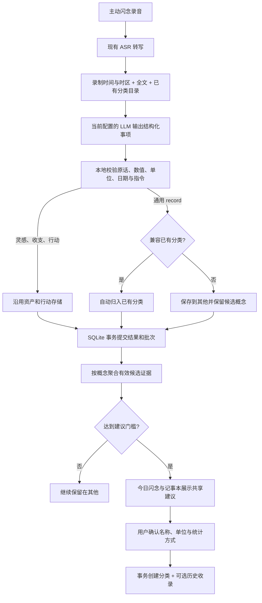

# WiseLife 本地存储与检索

原始说明更新：2026-11-16；本次修订：2026-11-08。本文记录元数据迁移、检索和恢复边界；完整的当前 iPhone/Watch 数据目录、SQLite 表与字段请看[本地数据结构](local-data-schema.md)。当前主库为 schema v16，本文不再作为完整表结构清单。本地资料不需要 WiseLife 服务器。

**Ask AI 当前增强：**[会话、上下文与工具编排](ask-ai-session-orchestration.md) 已获批准并实现首期运行时，复用聊天主表并增加五类附属缓存。完整历史保留，UI 每次 10 轮分页；模型独立读取最多 40 个完成轮次，采用有界用户问题背景而非完整语义摘要。Apple 26.3 使用原生只读 Tool，自定义服务适配两种工具协议，ChatGPT/Mac 仍走文本路径；验证和未完成项见主说明。

## 数据分工

| 数据 | 保存方式 | 原因 |
| --- | --- | --- |
| 录音、图片文件 | 保留原有目录、文件名及 UUID | 播放与传输继续直接访问媒体文件，不把大媒体写入数据库 |
| 录音元数据、转写、总结、说话人 | SQLite `voice_notes`：可查询列 + 完整 Codable 快照 | 定点更新；迁移完整保留来源、转写段、说话人、处理状态和版本信息 |
| 图片记录、附件、备注及 OCR | SQLite `photo_moments` / `photo_attachments` | 记录与有序附件在同一事务保存，保留每图 OCR 和识别错误 |
| 提醒内容、时间、状态、通知 ID | SQLite `daybook_reminders` + 系统本地通知 | 保留既有调度与失败补偿；更新时检查旧版本，避免覆盖其他实例的数据 |
| 媒体删除标记 | SQLite `media_tombstones` | 文件删除失败可重试；重启孤儿恢复不会重新导入已删除的录音 |
| 生活来源开关、每日快照、记录与删除抑制 | SQLite 逐行表 | 可按来源、日期增量更新；事务与索引保证一致性 |
| AI 对话、逐轮问题/回答/引用/状态 | SQLite | 全部保存；最近 10 轮起步，游标分页加载更早的 10 轮 |
| 我的声音档案 | iOS Keychain 通用密码项（`<Bundle ID>.voice-profile`） | 仅此设备、设备解锁后可读、关闭 Keychain 同步；不进入全文或语义检索索引 |
| 每日洞察、忽略反馈、生成次数 | SQLite | 原子预留生成次数，错误或取消不会意外绕过额度 |
| 全文投影、文本分段、向量与进度 | SQLite FTS5 / 子串查询 + SQLite Vector | 可删除、可重建的派生索引，不替代原始资料 |
| API Key | 沿用 Keychain | 不写入 SQLite、检索索引或日志 |

数据库位置：`Application Support/WristNotes/Database/daybook.sqlite3`。使用系统 SQLite、外键、绑定参数、连接内串行访问、事务、WAL、FULL synchronous 和 5000ms busy timeout。2026-11-01 按 `DaybookDatabase.swift` 勘误：数据库目录及 DB/WAL/SHM/rollback journal 使用 `completeUntilFirstUserAuthentication` 文件保护，重启首次解锁前不可用，首次解锁后可供后台接收使用；所在 `WristNotes` Application Support 树排除备份。此处修正文档，不修改录音/图片或数据库代码。

数据库日期沿用 Swift reference-date 秒数，包含有效的 2001 年之前日期。主库采用增量迁移，当前版本与所有持久表见[本地数据结构](local-data-schema.md)。

## 业务元数据迁移与恢复

- `Documents/VoiceNotes/notes.json`、`Documents/PhotoMoments/moments.json`、`Documents/DaybookReminders/reminders.json` 首次打开时按领域迁入 SQLite。既有生活/对话 JSON 及洞察 UserDefaults 继续使用原迁移机制。
- 数据校验、记录写入和迁移完成标记位于同一事务；失败整体回滚。坏 JSON 或数据库错误会明确报错，不静默返回空资料库。修复后可以重新打开重试。
- 成功后以 SQLite 为主存储，旧 JSON 原字节作为恢复副本保留，不再更新或重复导入。后续删除数据库记录不会同步擦除这些旧恢复副本；备份生命周期应单独管理。
- 默认三个真实 App 目录共用上述数据库。任意测试或导入目录使用各自的 `metadata.sqlite3`，不会按相似目录名连接用户库。
- 录音保存媒体并提交元数据后，原有调用方才发送 Watch 接收确认。UUID 重传不新增重复记录，也可修复缺失音频。
- 解锁可用通知和回到前台会触发录音、照片、提醒存储重试。首次元数据打开失败不会阻止 Watch 接收初始化；录音保留在 Inbox，数据库恢复后重放，成功导入后才确认。暂时失败保留已发布的列表，录音处理依据持久状态恢复并避免重复启动。
- 写入失败保留原记录、内存状态和可重试的录音草稿；清理候选媒体前会在数据库事务中重新检查归属，避免删除另一连接已成功采用的文件。
- 录音及图片删除先提交删行和清理标记，再清理文件；失败留待重新打开时重试。明确重新导入同一录音 UUID 可以恢复记录，成功时原子清除对应删除标记。
- 领域重置不会清除其他领域数据；密钥继续存于 Keychain。

语音、图片等页面仍向上层提供完整内存数组；AI 对话历史使用下面的 SQL 分页。主要关键词检索已消费 SQL 全文索引结果，尚未将所有页面查询或统计下推到 SQL，也未增加跨日事实问答。转写时间段和说话人附加数据保留在录音 Codable 快照中；本阶段的文本索引使用原文字符范围，不伪造时间或说话人关联。

## AI 对话历史

- 所有已发送问题保存在 `conversation_turns`，不再因超过每天 20 轮、30 个日期或旧 JSON 文件体积阈值而裁剪。10 是页面大小，不是保存上限。
- AI Tab 展示跨日期的聊天历史；选择日期只决定本次查询资料的范围。首次读取最近 10 轮，页面顶部下拉或点击“加载更早的 10 轮对话”继续读取。
- 以 `(created_at, id)` 作为稳定游标，使用复合索引与 `LIMIT 11` 判断是否还有更早内容；每次最多展示新增 10 轮。按 UUID 保存/更新一轮，避免回复时覆盖全部历史。
- 发送问题时先保存 `pending`；成功、失败、取消都更新同一 UUID。App 重启后将未完成请求标为中断，保留问题。首次保存失败不会调用模型，显示错误并提供重试。
- 新增录音、转写完成、修改资料、生活数据刷新与暂时缺少来源不删除历史。资料已变化的回答显示历史提示，后续请求不沿用其旧回答文本，引用重新对应当前允许的原文。
- 关闭来源读取权限时保留用户问题，清除相关回答和引用。清理失败时界面仍隐藏相关回答且可重试；重新授权不会恢复已清除的回答。用户可明确清除全部对话。
- `conversation-history-v2` 领域迁移增加发送时间、状态和排序索引；旧记录缺少逐轮时间，使用原线程更新时间和顺序回填。旧 JSON 原字节仍保留，旧 SQLite 数据不会被重新导入覆盖。

## 我的声音档案恢复

声音档案保存在本机 Keychain 通用密码项，service 为 `<App Bundle ID>.voice-profile`、account 为 `profile`。项目使用 `WhenUnlockedThisDeviceOnly` 且关闭同步，不发送给 WiseLife 服务器，也不启用 iCloud Keychain 同步；设备锁定时不可读取。Apple 文档说明 `ThisDeviceOnly` 项不会迁移到另一台设备，但没有承诺 App 卸载后一定保留，因此同机重装保留行为仍需按实际签名和设备验证。

首次读取时，如果 Keychain 中尚无档案，会迁移旧版 `Application Support/WristNotes/PrivateVoiceIdentity/profile.json`。只有新档案成功写入 Keychain 后才尝试删除旧文件；写入失败会保留原文件并显示读取错误。明确删除“我的声音”会删除 Keychain 项和仍存在的旧版文件。登记录音仍是临时文件，离开登记页面不会删除已保存的声纹档案。

声纹登记从至少 3 个清晰语音窗口生成归一化特征，以声纹中心检验各窗口的一致性；5 个及以上窗口中，只有能唯一确定单个异常窗口且其余窗口仍一致时，才排除该窗口后保存。后续识别同时要求查询窗口彼此一致、且每个窗口都接近登记声纹中心；不确定时保留普通说话人标签。阈值属于工程默认值，尚未用真人多设备数据集校准，不能作为身份认证使用。

- 仅文件明确不存在时显示“未登记”；读取或校验失败显示“声音档案暂时无法读取”，保留上次成功读取的档案。
- 解锁后、回到前台、进入声音登记页或设置入口时重新读取，也可手动重试。读取失败时阻止用新登记覆盖未知的旧状态。
- 模型和真实临时文件的恢复测试已覆盖保存后重建、取消退出、读取错误和重试。模拟器上的 UIKit 生命周期测试不能证明真机锁屏文件保护行为。

## 全文关键词检索

- `fulltext_records` 保存完整标题、原文、总结的归一化文本以及 UUID、日期、类型、完整内容指纹；`fulltext_fts` 使用系统 FTS5 trigram。归一化为 NFC + 固定 `en_US_POSIX` case folding，版本 `nfc-casefold-posix-v1`。
- 三个及以上 Unicode scalar 的词项使用绑定参数的 FTS 字面查询，再做 SQL 字面子串校验；较短词项用 SQL `instr`。分词器不可用时整条查询降级为有范围约束的 SQL 子串查询，恢复可用时原子回填已有投影。
- SQL 先约束日期，AI 查询同时约束请求类型和已允许来源。资料库关键词包括全部本地来源的标题、原文和总结；问 AI 只匹配允许来源的标题与原文，不用生成总结作为事实。
- 更新和删除只修改变化行，全文投影与 FTS 同一事务提交。数据库不可用或索引写入失败时，使用当前内存原文匹配；失败不会伪装成成功的空结果。
- 返回结果绑定查询、日期、当前内容与来源权限。资料库另校验所有本地来源快照，未允许 AI 读取的来源发生编辑也会使其旧关键词结果失效。SQL 分数与语义结果合并后按 UUID 去重，引用仍核对当前原文。

## SQLite Vector 的使用边界

- 静态编译官方 `sqliteai/sqlite-vector 1.1.2`，固定提交 `0c2223ada9dce1fa33248c8835a15f51d9a0f655`；与系统 SQLite 链接，显式初始化，不动态加载扩展。许可证及来源见 `Vendor/SQLiteVector/PROVENANCE.md`。
- 向量使用 Apple NaturalLanguage 上下文模型，token 均值做 L2 归一化。2026-10-31 中英实验后不再优先使用句向量；上下文资源缺失时使用关键词，并提供显式下载入口。模型、修订、维度、语言和 pooling 版本共同标识向量空间。旧句向量在下次检索时逐批重建，不与新模型混用。不调用云端 embedding。
- 可选简体中文、英语、繁体中文、日语；是否可用取决于当前设备的 Apple 资源。缺资源时需用户主动下载；这些语义检索资源独立于语音转写/Whisper 资源。
- 选择简体中文或英语时，中英及混合问题可通过 Apple Translation 在端上翻译为索引语言，仅译文参与语义查询向量。原问题仍用于日期、来源类型、姓名、关键词、历史与回答提示；原文不翻译，译文不是证据。不融合原问题跨语言向量排名，以免削弱实验中更有效的译文排名。
- 翻译语言包与上下文向量资源分开管理。在「设置 → AI 检索 → 本地语义检索」点击准备语言包，通过系统前台 UI 下载；普通查询只使用已安装资源。缺失、失败、不可用时保留原问题检索。模拟器不运行 Apple Translation，需在真机验证。成功译文仅缓存最近一次于内存，绑定问题、语言、检索 generation 和资源 revision；不写入 SQLite，清除或失效后不可回写旧结果。
- 仅索引允许 AI 读取的原始文字。图片使用已有 OCR 文字，不创建图片向量；不把生成的总结作为新的事实来源。
- SQL 先筛选当前日期、来源种类及向量模型，再将候选向量分批放入独立内存 SQLite 表执行真实 cosine scan；按距离与原始记录 UUID 合并所有批次的结果。不会在全库 top-k 后才剔除无权读取的来源。
- 资料库保留所有关键词直接命中，包括未允许 AI 读取的资料；语义补充只读取 AI 已获允许的来源。问 AI 继续核对原文、日期与稳定引用，远端模型仍需确认完整外发内容。
- 编辑、删除、权限撤销和模型变更使旧向量失效。删除索引不删除原始记录；取消或迟到任务不能重新写回已清理的旧索引。

## 当前规模与性能选择

个人当天检索采用分批精确扫描，尚未引入量化、ANN 或独立向量服务：

- 完整原文优先按句子边界分段，每段最多 600 个 Swift Character，相邻段最多 80 字重叠；持久保存顺序与字符起止范围。没有前 1,800 字的永久上限。
- `semantic_records` / `semantic_chunks` 保存完整内容与分段版本指纹、模型空间、总段数及 `pending` / `ready` / `unavailable` 状态。一次事务升级旧 v1 派生缓存，保留业务主表。
- 每次请求最多处理 64 个新原文分段，另生成一次查询向量；多个记录轮转推进，已完成段复用。新的数据库连接或 worker 可以继续既有进度；不可用段不会无期限重试，也不阻塞其他记录，资源变化后可重试。
- 取消旧的 1,365 条记录淘汰和 4,095 段总量截断。SQL 按 keyset 读取，每批最多 4,095 个候选进入真实向量扫描；通过实际距离合并全范围最优记录。扫描内存随批量和最终 top-k 有界，查询结果最多 40 条，通常 20 条。
- 仅在资料库页面可见且 App 在前台时逐批发布进度并继续补齐，批次间让出执行权。离开资料库、取消、清空、换查询或范围会使旧任务失效；返回资料库可续建，没有常驻后台索引服务。问 AI 使用当前批次和完整关键词结果，不等待所有向量完成。
- 状态分别显示完成、待处理、不可用段数和模型窗口限制。分段都已处理不能证明 Apple 模型覆盖了全部 token；语义质量与大规模耗时仍需真机验证。

这里的距离用于排序，不向用户显示未经校准的可信度百分比。Ask AI 使用原问题解析的日期范围；资料库使用选定日期。跨语言查询目前仅支持中文与英文之间的本机问题翻译，仍在一个所选语言的向量空间内检索，不代表所有语言共享一个向量空间，也不保证翻译保留每个细节。

## 基于联系人关联的 Speaker Ask（已实现范围）

联系人资料与说话人关联现已写入 iPhone 本地 SQLite（主库迁移版本 16）。用户从系统通讯录选取联系人或手动录入联系人后，可以在当前录音中关联、换绑和解除。Speaker Ask 在问题能匹配联系人/本人意图时走专用检索；通用 Ask 保持原有日期范围。没有明确日期的联系人问题跨已关联录音检索。

### 归属规则

- 仅在用户于某条录音中手动将 `speaker_id` 关联到通讯录联系人后，才把该录音中的对应发言归给该联系人。联系人关系按录音源保存，同一联系人可在多条录音中分别关联不同的 `speaker_id`；不做跨录音声纹身份推断。
- 闪念（`.thought`）不运行说话人分离或声纹身份推理，统一视为用户本人发言。全文显示“我”，处理状态说明无需说话人分析，不提供改名、换绑联系人或重试识别入口。检索层将它映射为虚拟 speaker `self`，不伪造逐字稿行的 `speaker_id`，也不写入联系人关联表。
- 闪念可参与“我说过什么”等本人发言查询，不参与对其他联系人的查询。录音时长本身不决定是否属于闪念；普通长录音（`VoiceNote.kind == .long`，投影为 `DayRecord.kind == .voice`）仍按其实际说话人分析和联系人关联处理。
- 说话人分析未完成、ASR 失败或 `speaker_id` 为空的文本不归属联系人；回答应说明证据覆盖不足，不能据此断言某人没有发言。

<a id="thought-speaker-20261108"></a>
### 闪念本人归属实现与验证（2026-11-08）

`NotesModel` 在读取本人声纹和调用说话人模型前跳过 `.thought`；旧版本遗留的运行中任务在恢复时清除过期分析状态，不重写全文、时间戳或历史 speaker ID。界面按录音类型显示本人归属，因此历史成功、失败或缺少说话人标签的闪念都显示“我”。这表示产品定义的归属，不表示声纹比对成功。

较长或时长未知的闪念继续使用有界分段转写。`AudioProcessingRepository` 从原始 `voice_notes.kind` 决定是否请求 speaker 阶段，首次处理、显式重试及资源恢复均不调用该阶段；`.notRequested` 不再使闪念反复进入说话人重试。已经成功的 ASR 内容保留，普通 `.long`／session 录音仍执行原有分析流程。

验证结果：

- 8 项 `NotesDiarizationTests` 通过，覆盖新闪念、历史分析状态恢复及普通录音分析。
- 分段仓储、说话人持久化／联系人／本人归属及 Speaker Ask 测试通过，覆盖 3 秒／601 秒／1 小时的闪念、过期显式 speaker 请求、保留 ASR 与本人／其他联系人查询隔离。
- iOS 模拟器测试构建与真机目标编译通过；真机目标使用 `CODE_SIGNING_ALLOWED=NO`，不代表签名归档或安装。BLE SDK 79 项校验、4 项构建开关测试通过，Pod 锁文件一致；构建仍报告本机 Metal 工具链搜索路径缺失的链接警告。
- 通用 `test_audio_processing_coordinator.sh` 的 interrupted partial retry 用例超时；使用本次修改前的源文件独立复现同一失败，未修改该既有用例或流程。
- 此变更尚未安装至真机或发布到 TestFlight。

<a id="thought-transcript-reading-20261108"></a>
### 闪念全文的连续阅读（2026-11-08）

Apple 转写可能提供逐词时间片。闪念全文现在直接显示已保存的完整 `transcript`，只显示一次“我”和整段转写的时间范围；保留原有标点、换行和整段编辑入口，不把时间中的数字、冒号或单个词各自渲染成一行。普通录音继续使用原说话人分段与逐段编辑。

这属于显示修复，不重新转写或改写 SQLite 中的 `transcriptSegments`。现场 20.78 秒闪念包含 62 个字、41 个原始时间片；原位更新 `WristNotes Transfer Test iPhone` 后，笔记数量、完整 payload、原音频 SHA-256 均与更新前一致，41 个原始时间片仍完整保存。模拟器编译、SDK 完整性及构建开关检查通过。窗口控制暂报 `cgWindowNotFound`，更新后的界面验收待窗口恢复；未安装真机或发布。

### 持久化关系

`contacts` 与 `recording_speaker_contacts` 位于 iPhone 本地 SQLite。迁移会将 `content_speaker_contacts` 和非闪念 `voice_notes.payload` 中已有的联系人快照迁移到新表；旧快照表/JSON payload 暂作兼容与恢复副本保留。`.thought` 闪念不会创建联系人映射：

```sql
CREATE TABLE contacts (
  id                         TEXT PRIMARY KEY,
  origin_type                TEXT NOT NULL CHECK (origin_type IN ('ios', 'manual')),
  system_contact_identifier  TEXT,
  display_name               TEXT NOT NULL,
  organization               TEXT,
  emails_json                TEXT NOT NULL DEFAULT '[]',
  phone_numbers_json         TEXT NOT NULL DEFAULT '[]',
  avatar_thumbnail           BLOB,
  sync_state                 TEXT NOT NULL CHECK (sync_state IN ('manual', 'current', 'needs_refresh', 'unavailable', 'missing')),
  created_at                 REAL NOT NULL,
  updated_at                 REAL NOT NULL,
  last_synced_at             REAL,
  CHECK ((origin_type = 'ios' AND system_contact_identifier IS NOT NULL
          AND sync_state IN ('current', 'needs_refresh', 'unavailable', 'missing'))
      OR (origin_type = 'manual' AND system_contact_identifier IS NULL
          AND sync_state = 'manual'))
);

CREATE UNIQUE INDEX contacts_system_identifier
  ON contacts(system_contact_identifier)
  WHERE system_contact_identifier IS NOT NULL;

CREATE TABLE recording_speaker_contacts (
  source_key       TEXT NOT NULL,
  speaker_id       TEXT NOT NULL,
  contact_id       TEXT NOT NULL REFERENCES contacts(id) ON DELETE CASCADE,
  linked_at        REAL NOT NULL,
  speaker_revision TEXT NOT NULL,
  PRIMARY KEY (source_key, speaker_id),
  FOREIGN KEY (source_key)
    REFERENCES audio_processing_sources(source_key) ON DELETE CASCADE
);

CREATE INDEX speaker_contacts_by_contact
  ON recording_speaker_contacts(contact_id, source_key);
```

`contacts.id` 是 WiseLife 内部稳定主键；iOS 联系人的值为 `ios:<CNContact.identifier>`，`system_contact_identifier` 只用于重新读取本机通讯录资料。`emails_json` 和 `phone_numbers_json` 保存带 label/value 的数组；`avatar_thumbnail` 保存压缩后且不超过 32 KiB 的缩略图。手工联系人使用相同资料字段，但不含系统联系人标识，`sync_state` 为 `manual`。iOS 联系人状态区分当前快照、待刷新、权限不可用和联系人不存在。当前实现只在用户重新选择同一通讯录联系人时刷新本地快照，不做后台通讯录同步；通讯录姓名被修改后不会自动即时反映到 WiseLife。

iOS 来源的联系人快照在系统联系人选择器返回资料时保存姓名、公司、邮箱、手机号和缩略图，并更新 `last_synced_at`。目前没有独立的“刷新联系人”入口，也不做后台同步；重新选择同一联系人时刷新快照。手工联系人可在建立关联时录入姓名、公司、邮箱和手机号。已有本机联系人可再次选择并关联到其他录音中的 speaker。实现只读取系统通讯录，不向系统通讯录写入 WiseLife 的记忆或跟进内容。

建立新关联前必须存在当前有效的录音处理源和该 speaker 的逐字稿 spans；旧 VoiceNote 若只有 payload 快照而没有可检索的处理数据，会显示为待复核，须先完成录音处理后再关联。这样 UI 不会把仅保存在旧 JSON 中的名字误报为可供 Speaker Ask 检索的关系。

`recording_speaker_contacts.source_key` 标识 session 或 legacy note 录音源；一个录音源中的一个 speaker 关联一个 `contacts.id`。同一联系人可关联多条录音中的不同 speaker；删除联系人行只级联删除这些关联，不删除录音或转写。`linked_at` 是用户最近一次确认建立/更换该关联的时间；同一主键再次保存会作为重新确认并更新时间。`speaker_revision` 是当前有效转写 spans 的稳定指纹；转写或说话人分配变化时，关联标为待复核，不会自动用于检索，须由用户重新确认。闪念的 `self` 是检索投影中的归属，不需要联系人行。

联系人字段仅用于联系人卡片、speaker 关联和本机 Ask 的联系人解析；不把电话、邮箱或头像发给 AI。历史快照迁移时可从旧映射恢复系统联系人标识、姓名和已有缩略图；旧数据没有的公司、邮箱和手机号保持为空，后续由用户刷新或补录。

逐字稿仍以 `audio_transcript_spans` 为事实来源。它保存带 `speaker_id` 的时间片段；查询通过 `audio_processing_jobs.source_key` 将片段连回录音源和联系人关系，不复制第二份逐字稿。迁移版本 16 新增 `audio_spans_speaker_time(speaker_id,start,end)` 索引。

### Speaker 语义索引

当前 Speaker Ask **尚未建立 `speaker_semantic_chunks` 向量缓存**。查询先通过关系表筛选 `source_key + speaker_id`，读取当前有效 spans，按连续录音片段聚合并用关键词匹配排序，再将有上限的逐字稿证据送入现有 AnswerService。它不会使用通用 `semantic_chunks` 做说话人语义排名，也不影响通用向量索引。主题相关但措辞不同的跨录音问题，当前召回效果受关键词排序和上下文上限影响；speaker-aware 向量分块/语义排序是后续增强，不属于本次已实现范围。

### 检索流程与能力范围

1. 解析联系人、问题意图和日期范围。联系人名称只匹配本机已建立的关联；同名且无法唯一确定时先消歧。追问中的“他/她”可沿用本地对话上下文中已解析的联系人。
2. 对联系人问题，先按 `contact_id` 查询关联录音和 `speaker_id`，校验 `speaker_revision` 后再读取该 speaker 的转写片段。对“我说过什么”，只纳入 `.thought` 的虚拟 `self` 记录。
3. 将连续的同一 speaker 片段组织为可检索文本块，保留每块覆盖的原始时间范围和录音源；绝不合并不同 speaker 的文本。
4. 对“在哪些会议/录音里出现”使用结构化记录查询和日期排序；对“在某次录音说了什么”读取对应发言；对“谈到某主题时说了什么”当前仅在该联系人的候选录音/片段中做关键词排序。
5. 生成的答案引用录音标题、日期和发言时间，点击引用可回到录音对应位置。沿用现有 AnswerService、授权模型和本地对话记录，不另建 Ask 历史系统。

当前支持：列出某联系人已关联且识别到发言的录音、总结其在指定录音中的发言、在已关联录音中按关键词查找主题、返回带时间位置的原文依据，以及检索用户自己的闪念。联系人检索没有指定日期时跨已关联录音；识别到明确日期或最近七天时会缩小证据范围。通用 Ask 的选定日期行为不变。

“参与过哪些会议”应表述为“哪些录音中识别到关联说话人”：说话人发言不能独自证明其真实出席；未关联录音不会被自动认人。端上先完成联系人匹配和证据筛选。若用户选择外部模型，只按现有授权规则发送回答所需的筛选文本，不发送通讯录标识、电话、邮箱或照片。

## 验收边界

编译、真实 C 扩展和合成数据测试可验证 SQL、迁移、排序、失效及并发控制，无法替代真机验证中文检索质量、Apple 资源下载、耗时、内存、能耗及锁屏文件保护。元数据迁移测试入口为 `sh scripts/test_metadata_sqlite.sh`；生命周期恢复使用 `scripts/test_storage_lifecycle_ios.rb` 生成独立模拟器测试工程；全文与完整分段使用 `sh scripts/test_semantic.sh`。

验证记录：[第一阶段元数据迁移](2026-10-20-metadata-sqlite-migration.md)、[第二阶段全文与分段索引](2026-10-20-fulltext-and-chunk-indexing.md)、[对话历史与声音档案恢复](2026-10-20-conversation-history-and-voice-recovery.md)。其他功能记录见 `prototype-completion-audit.md`。

## Ask AI 运行内检索与保存（2026-11-01）

- 初次检索仍使用现有关键词/FTS/Apple embedding 与端上查询翻译；工具只读已取得的本轮范围快照，每次请求/提交前经过来源新鲜度校验。
- 局部查询的缺失 ID 不代表删除；范围 A→B→A 保留范围外缓存。同 UUID 的不同日期投影在翻译 await 后重新校验，防止宽范围正文被窄范围查询复用。
- 运行 SQL 放在串行后台 worker，短事务内不 await；原位重试不新增 turn，保存失败只重试发布，不重新请求模型。
- 运行证据有界存储、工具参数仅保留摘要与空对象；不保存 API Key 或完整录音逐字稿。权限/清空历史会清理证据、意图记忆、Transcript，并增加缓存代次，拒绝迟到缓存写回。
- 当前健康工具最多给出 5 条有来源的样本小计；超出会明确 partial，不能当完整长范围总数。Speaker SQL 下推和独立 Reader 仍在后续范围。

<a id="life-ledgers-20261113"></a>

## 2026-11-13 · 闪念分类识别与共享生活账本

> 发布范围（2026-11-16）：本次提交仅包含账本相关文档，描述已核对的本地工作区实现；配套原生源码和可运行原型尚未随本次提交推送。

适用：iPhone 主动闪念的整理、生活分类发现、首页与记事本共享查询。实现基线：2026-11-13；说明更新：2026-11-16，按当前工作区源码核对。产品约定见[闪念分类](../prototype/flash-assets-design.md#flash-home-categories-20261113)，表结构见[SQLite 生活账本](local-data-schema.md#life-ledger-schema-20261113)，模型契约见[提示约束](ai-prompts.md#flash-ledger-extraction-20261113)，编译和模拟器证据见[实施记录](superpowers/plans/2026-11-13-life-ledgers-native.md)。

### 职责与流程

LLM 负责理解原话并提出结构化事实和概念；本地代码负责证据核对、已有分类匹配、去重、候选阈值、用户决定与事务。模型不执行 SQL，不生成可执行统计公式，不直接启用分类。原录音和转写先保留，分类确认不阻塞采集保存。



| 职责 | 当前代码入口 |
| --- | --- |
| 模型输入、窗口预算、调用 | [FlashCaptureService.extract](../Sources/iPhone/FlashCaptureService.swift) |
| Prompt、JSON 解析与证据核对 | [FlashCaptureParser](../Sources/iPhone/FlashCapture.swift) |
| 类型、单位与定点数量 | `LifeLedger.swift`（本地源码：`../Sources/iPhone/LifeLedger.swift`） |
| 匹配、候选、分类事务与统计 | `LifeLedgerRepository`（本地源码：`../Sources/iPhone/LifeLedgerRepository.swift`） |
| 混合结果原子提交、共享刷新 | [FlashCaptureRepository](../Sources/iPhone/FlashCaptureRepository.swift) · [FlashCaptureModel](../Sources/iPhone/FlashCaptureModel.swift) |
| 只读 AI 查询与来源权限 | [AskAINotebookReader](../Sources/iPhone/AskAINotebookReader.swift) |

`FlashCaptureService` 沿用已配置的本机 Foundation Models、自定义模型、ChatGPT 或 Mac 推理路线，以及已有外发授权。当前目录上限为八项；外部调用过滤仅本机来源的分类定义。普通历史升级不自动重放旧行动指令。

### 提取与确定性校验

一次输出最多 12 个事项，支持灵感、收支、待办、提醒、日程和通用生活记录。一条混合闪念可同时包含多个结果，但原录音只保留同一个来源关联。

- 通用记录携带 `conceptKey/conceptName/measure/value/unit/date/mode/confidence/factScope/quote`。概念键用于匹配，显示名称可以独立设置。
- `quote` 必须是全文中的连续原话。模型须区分提问、否定、转述、未来计划与已发生事实；本地再用所在句子的关键词规则核对事实／追踪请求，命中否定等规则时降为不确定记录。这是保守启发式校验，不能证明任意自然语言事实都识别正确。
- 数值必须同时满足固定精度格式与原话核对，支持阿拉伯数字、常用中文数词及兼容单位的精确转换。无法核对或单位维度不匹配时保留缺失值。
- 日期核对明确 ISO 日期，或按已知录制时区计算今天／昨天／前天等表达。无法核对的发生日期留空，不使用接收／上传时间代替。
- “以后帮我记录饮水”属于追踪请求，可提出分类预览，不算一次饮水；“今天一共 900 ml”属于周期总量，不与单次增量相加。
- 未知模型 kind 在共同字段有效时保留为 `other` 概念的原话记录，置信度为 0、日期和数值为空，不参与统计或被动发现；不会仅因 kind 未知就使同批其他结果失败。JSON 格式、数量上限、原话存在性等共同校验失败仍使本次整理失败，保留录音和转写供重试。

### 已有分类匹配与新分类建议

已有分类按 `conceptKey` 精确相等、度量类型相等及规范单位相等匹配，不以显示名称或向量相似度直接归类。`ml/L`、`min/h/s` 等在本地换算；同义词归一化目前主要依赖模型结合现有目录，还没有完整分类别名表或向量聚类机制。

| 情况 | 处理 |
| --- | --- |
| 命中已启用兼容分类 | 自动归档，不重复询问 |
| 明确追踪请求 | 可立即进入分类建议，但仍受暂缓／拒绝决定约束，不计入事实次数 |
| 被动发现 | 最近 30 天至少 3 条去重后的事实记录，跨至少 2 个已知发生日期，单位维度兼容，平均模型置信度至少 0.75 |
| 证据不足 | 保留在其他，继续观察 |
| 以后再说 | 持久保存证据集合；至少冷却 7 天且出现新的独立证据才再提示 |
| 不再建议 | 持久抑制该概念的自动建议；仍允许手动创建 |

具体筛选顺序为：取最近 `30 × 86400` 秒内采集且未撤销的记录 → 排除已存在的概念键 → 按概念、度量和规范单位分组 → 检查明确请求或事实阈值 → 应用用户决定。同一概念最多返回一个兼容维度的候选；已有概念遇到不同单位维度时仍留在其他，不自动创建第二个同键分类。

事实分支还要求 `occurredOn` 在窗口起止的日期范围内。当前起止日按 UTC 生成，发生日期则来自原录制时区；这不是完整的跨时区自然日窗口，临界日期需要单独评估。候选使用整组平均置信度，没有逐条 0.75 的前置筛选；统计则有逐条门槛，两者不能混为一谈。模型置信度不是经过校准的准确率。

次数按去重后的记录计，原话中“三次”仍只提供一条证据。去重限定在同一来源 ID、概念与空白归一化原话；跨来源重述同一件事、模型改写概念键或改变引文范围不保证合并。修改／撤销后动态重算，候选不另存一份“观察事实”；`ledger_decisions` 保存的是用户决定和当时的记录 ID 集合。

### 确认、共享查询与一致性

启用分类最多八项，包含默认记账和其他；新安装不预置原型中的饮水、网球等演示分类。达到八项后禁用创建并在事务内再次检查，不丢弃仍留在其他的记录。用户确认前可调整名称、单位和统计方式，历史收录逐条勾选且默认关闭。创建分类、数量上限校验和所选历史收录在同一事务完成，保留原记录 ID、来源及原话；未选的历史记录继续留在其他，之后的新匹配记录自动归档。

首页按 `captured_at` 查看所选采集日期；记事本按 `occurred_on` 分页查看历史与统计。保存后刷新同一数据库的投影，不维护两份业务记录。手动文字记录和来源已删除的整理结果仍可回看，没有音频时不显示虚构时长或播放器。

`FlashCaptureRepository.commit` 将旧资产、通用记录、行动意图和批次完成状态一并提交。通用记录以来源 ID＋概念键＋空白归一化连续原话构成幂等键；正文改写、提取日期或数值不作为身份。`importRecords` 命中已有 ID／幂等键时返回原结果，保留人工编辑和撤销状态；编辑通过 `revision` 乐观锁拒绝旧版本。原音频删除不级联删除已保存的账本记录和分类决定。

### 统计、检索与隐私

通用数量采用六位小数定点整数，输入范围和换算溢出由本地校验。SQLite 处理完整符合条件的集合，不从分页结果求和。所有统计先过滤未撤销、非追踪请求、逐条 `confidence >= 0.75`，外部查询再过滤仅本机记录。

| 分类统计方式 | 纳入数据与计算口径 |
| --- | --- |
| `sum` 累计增量 | 已知日期的 `increment`，对非空规范数量执行 `SUM(quantity)` |
| `count` 记录条数 | 已知日期的 `increment`，执行 `COUNT(*)`；“打了三次网球”一条记录仍计一条，若要累计次数应选数值求和 |
| `average` 平均测量 | 已知日期的 `measurement`，非空数量求和后除以有值条数；整数除法截取到六位小数精度 |
| `latest` 最近测量 | 已知日期、非空数量的 `measurement`，按发生日、采集时间、ID 倒序取第一条 |

`periodTotal` 保留在明细和覆盖计数中，不加入上述汇总。`recordCount` 是筛选范围内基础记录数，不等于参与数值汇总的条数；`missingValueCount/periodTotalCount/measurementCount` 补充范围内覆盖情况。`unknownDateCount` 在日期筛选前按整个分类计算，不能读作“本周日期未知的条数”；日期未知记录不进入数值／日统计。日统计按 `occurred_on` 分组。缺少记录不等于现实活动量为零。

Repository 的 `from/through` 两端包含；Ask AI 的 `start/end` 是左闭右开日期区间，调用仓库时将 end 转为前一天。财务仍使用旧 `flash_assets` 与 `FlashMoney`，按币种独立汇总整数最小货币单位。

Ask AI 的 `queryLifeLedger` 在既有账本权限下提供 `catalog/search/detail/stats`，只读、每页最多 10 项、参数化查询；SQL 统计不依赖向量命中数量。类别和记录修改推进 ledger 领域版本，使旧引用与压缩记忆失效。通用生活记录目前在正文和概念名称上使用 SQL 子串检索；不维护独立向量索引，向量检索不是分类或计量的前置条件。

Ring 等仅本机来源的记录、由其生成的分类定义及包含此类资料的统计引用继承外发限制。创建分类时保守检查同概念的全部仅本机记录（包含已撤销），即使没有勾选历史收录也保留限制。统计引用需覆盖所有返回字段的来源，包括所选日期范围外的“日期未知”覆盖计数。

### 当前边界

当前没有实现任意自定义字段、完整别名维护、分类排序／重命名／归档及恢复拒绝建议专门页面。真实模型对不同语言、口音、主题归一化和复杂日期表达的质量需要独立评估；当前无法确认的字段保守保留待补充。
